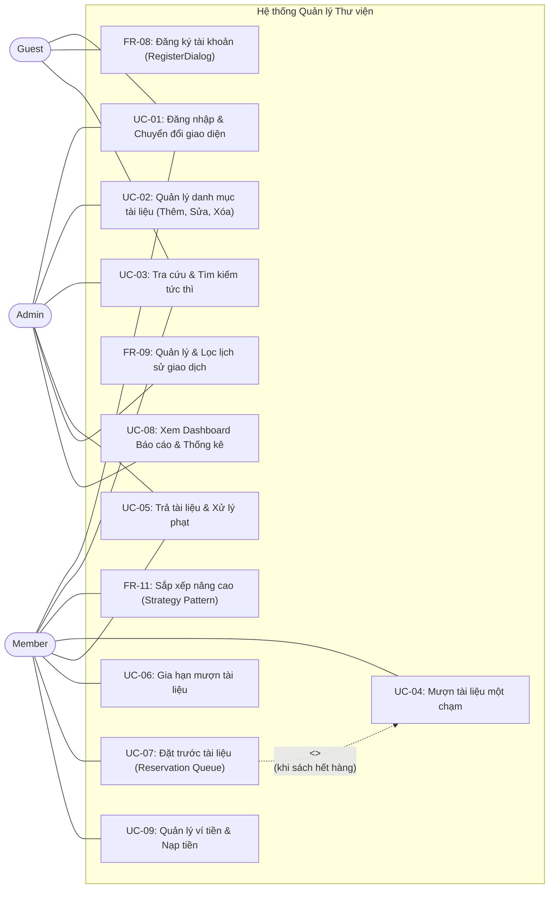

# BÁO CÁO ĐỒ ÁN MÔN HỌC LẬP TRÌNH HƯỚNG ĐỐI TƯỢNG (OOP)
## Đề tài: Hệ thống Quản lý Thư viện (Library Management System – Desktop GUI)

---

# MILESTONE 1 – PROBLEM ANALYSIS (Phân tích bài toán)
*(Tương ứng giai đoạn: Mô tả Requirements và Use Cases – Sau chương 1)*

## 1.1. Mô tả bài toán & Mục tiêu hệ thống
Trong hoạt động quản lý thư viện truyền thống (sổ sách thủ công hoặc ứng dụng dòng lệnh đơn giản), việc tra cứu đầu sách, kiểm soát số lượng bản sao, theo dõi hạn trả, tính phí phạt trễ hạn và quản lý các loại học liệu đa dạng (sách in, tạp chí, luận văn, sách điện tử) thường tốn nhiều công sức và dễ sai sót.

Đồ án xây dựng **Hệ thống Quản lý Thư viện (Library Management System)** dưới dạng **ứng dụng Desktop GUI phát triển bằng Java Swing & AWT** theo kiến trúc **MVC (Model - View - Controller)** và lưu trữ dữ liệu bền vững bằng tập tin CSV (`UTF-8`). Hệ thống hướng tới hai mục tiêu song hành:
1. **Về nghiệp vụ:** Tin học hóa trọn vẹn quy trình mượn/trả, gia hạn, đặt trước theo hàng đợi, thu phí phạt qua ví độc giả và thống kê điều hành cho thủ thư trên giao diện đồ họa trực quan.
2. **Về kỹ thuật OOP:** Vận dụng chuẩn mực 4 nguyên lý cốt lõi (**Đóng gói, Kế thừa, Đa hình, Trừu tượng**), **Java Collections Framework**, **Java Stream API**, **Xử lý ngoại lệ** và **Strategy Pattern**.

## 1.2. Các Tác nhân (Actors)
Hệ thống phục vụ 3 nhóm tác nhân thông qua các màn hình giao diện chuyên biệt:
* **Admin (Quản trị viên / Thủ thư):** Đăng nhập vào `AdminDashboardFrame`. Có toàn quyền quản lý danh mục tài liệu (Thêm, Sửa, Xóa), xem và lọc lịch sử giao dịch toàn thư viện, tiếp nhận trả sách, thu tiền phạt và theo dõi báo cáo thống kê (KPI Cards, Top 3 tài liệu mượn nhiều nhất, danh sách nợ quá hạn).
* **Member (Độc giả):** Đăng nhập vào `MemberDashboardFrame`. Có thể tra cứu tài liệu với tìm kiếm tức thì (Live Search), sắp xếp sách theo nhiều tiêu chí, mượn tài liệu một chạm, gia hạn mượn (+7 ngày), đăng ký hàng đợi đặt trước khi hết sách, xem lịch sử mượn cá nhân và nạp tiền vào ví cá nhân.
* **Guest (Khách vãng lai):** Không cần đăng nhập. Có thể mở `GuestCatalogFrame` từ màn hình đăng nhập để xem danh mục công khai và tìm kiếm tài liệu, hoặc mở hộp thoại `RegisterDialog` để đăng ký trở thành `Member`.

## 1.3. Yêu cầu Chức năng (Functional Requirements)

| Mã YC | Tên Chức năng | Mô tả yêu cầu |
| :--- | :--- | :--- |
| **FR-01** | Giao diện Đồ họa (GUI) | Xây dựng bằng Java Swing (`JFrame`, `JPanel`, `JTabbedPane`, `JTable`, `JScrollPane`, `JOptionPane`). |
| **FR-02** | Đăng nhập & Phân quyền | Xác thực `userName`/`password`, điều hướng sang `AdminDashboardFrame` hoặc `MemberDashboardFrame` theo vai trò. |
| **FR-03** | Quản lý Tài liệu (CRUD) | Thủ thư thêm, cập nhật, xóa tài liệu qua Form và bảng `JTable`; kiểm tra dữ liệu nhập và đồng bộ file. |
| **FR-04** | Tìm kiếm Tức thì (Live Search) | Lọc danh sách tài liệu theo thời gian thực khi gõ phím (`DocumentListener`), hỗ trợ tiêu chí: *Tất cả, Tiêu đề, Tác giả, Mã ID* (không phân biệt hoa thường và dấu tiếng Việt). |
| **FR-05** | Mượn Tài liệu Một Chạm | Kiểm tra tài khoản không bị khóa, hạn mức tối đa 3 cuốn đang mượn, không mượn trùng cuốn đang giữ, kiểm tra `canBorrow()`, tạo phiếu mượn hạn 14 ngày và trừ tồn kho. |
| **FR-06** | Trả Tài liệu & Tính Phạt | Tính số ngày quá hạn (`LocalDate`), tính phạt `5.000 VNĐ/ngày`, hỗ trợ trừ trực tiếp từ ví độc giả hoặc ghi nợ, và xử lý hoàn trả kho/hàng đợi. |
| **FR-07** | Lưu trữ File I/O | Tự động nạp dữ liệu từ file CSV (`users-v2.csv`, `documents-v2.csv`, `transactions-v2.csv`, `holds-v2.csv`) khi khởi chạy và đồng bộ lưu ngay khi có thay đổi. |
| **FR-08** | Đăng ký Tài khoản | Khách đăng ký tài khoản `Member` qua `RegisterDialog`, kiểm tra định dạng và trùng lặp tên đăng nhập. |
| **FR-09** | Quản lý & Lọc Giao dịch | Hiển thị lịch sử giao dịch trên `JTable`, hỗ trợ lọc theo trạng thái: *Tất cả, Đang mượn, Đã trả, Quá hạn*. |
| **FR-10** | Gia hạn Mượn (Renew Loan) | Gia hạn thêm 7 ngày cho giao dịch đang mượn với 3 điều kiện: chưa từng gia hạn (`isRenewed == false`), chưa quá hạn và không có người chờ trong hàng đợi. |
| **FR-11** | Sắp xếp Nâng cao | Sắp xếp sách theo 3 tiêu chí (*Tên sách A-Z, Năm xuất bản mới nhất, Số lượng tồn kho nhiều nhất*) áp dụng **Strategy Pattern** (`IBookSorter`). |
| **FR-12** | Hàng đợi Đặt trước (FIFO) | Khi sách hết bản sao (`quantity == 0`), cho phép độc giả đăng ký vào `Queue` (`waitingList`). Khi có người trả, giữ sách riêng cho người đứng đầu hàng đợi. |
| **FR-13** | Báo cáo & Thống kê Dashboard | Thẻ KPI (Tổng tài liệu, Đang mượn, Quá hạn, Doanh thu phạt) + bảng Top 3 tài liệu mượn nhiều nhất + danh sách quá hạn bằng **Java Stream API**. |
| **FR-14** | Đa dạng hóa Tài liệu | Quản lý 4 loại ấn phẩm kế thừa `Document`: `Book`, `Magazine`, `Thesis` (chỉ đọc tại chỗ), `EBook` (không giới hạn số lượng, phí trễ = 0). |
| **FR-15** | Ví tiền & Khóa tài khoản | Quản lý `balance` và `unpaidFine` trên `Member`; nợ phạt vượt quá `50.000 VNĐ` tự động khóa (`banned = true`), nạp đủ tiền trả nợ sẽ tự mở khóa. |

## 1.4. Yêu cầu Phi chức năng (Non-Functional Requirements)
1. **Giao diện & Trải nghiệm (UI/UX):** Áp dụng `Nimbus Look & Feel`, hỗ trợ phím tắt (`Enter` để xác nhận, `Esc` để đóng hộp thoại).
2. **Hiệu năng:** Tìm kiếm tức thì và sắp xếp trên bộ nhớ phản hồi nhanh, không gây treo giao diện người dùng.
3. **Toàn vẹn dữ liệu:** Đọc/ghi tập tin chuẩn `UTF-8`, có cơ chế tìm đường dẫn linh hoạt và sao lưu ngay sau các thao tác thay đổi dữ liệu.
4. **Kiểm soát ngoại lệ:** Mọi lỗi nhập liệu hoặc vi phạm nghiệp vụ đều được bắt và hiển thị thông báo tiếng Việt thân thiện qua `JOptionPane`, không làm dừng chương trình đột ngột.
5. **Khả năng mở rộng:** Thiết kế hướng đối tượng tuân thủ nguyên lý Đóng/Mở (OCP), dễ dàng bổ sung loại tài liệu hoặc chiến lược sắp xếp mới.

## 1.5. Sơ đồ & Đặc tả Use Case (UC-01 đến UC-09)

**Tóm tắt 9 Use Case cốt lõi:**
* **UC-01 – Đăng nhập & Chuyển đổi Giao diện (`Admin`, `Member`, `Guest`):** Nhập `userName`/`password` trên `LoginFrame`; xác thực qua `UserManager` để mở `AdminDashboardFrame` hoặc `MemberDashboardFrame`; khách có thể mở `GuestCatalogFrame` hoặc `RegisterDialog`.
* **UC-02 – Quản lý Danh mục Tài liệu (`Admin`):** Chọn loại tài liệu (`Book`, `Magazine`, `Thesis`, `EBook`), nhập thông tin trên Form để Thêm mới, chọn dòng trên `JTable` để Cập nhật hoặc Xóa (có hộp thoại xác nhận) và tự động lưu xuống file CSV.
* **UC-03 – Tra cứu & Tìm kiếm tức thì (`Guest`, `Member`, `Admin`):** Chọn tiêu chí tìm kiếm và gõ từ khóa vào ô tìm kiếm; `DocumentListener` tự động lọc và cập nhật `JTable` ngay lập tức.
* **UC-04 – Mượn Tài liệu Một Chạm (`Member`):** Kiểm tra `banned == false`, số sách đang mượn `< 3`, không đang giữ bản sao khác của tài liệu đó và `canBorrow()`. Nếu là `Thesis` thì từ chối (chỉ đọc tại chỗ); nếu `Book` hết hàng (`quantity == 0`) thì gợi ý chuyển sang **UC-07**; hợp lệ thì tạo `Transaction` hạn 14 ngày và giảm tồn kho.
* **UC-05 – Trả Tài liệu & Xử lý Phạt (`Admin`, `Member`):** Tính ngày trễ hạn và tiền phạt (`5.000 VNĐ/ngày` đối với `Book`/`Magazine`). Cho phép trừ ví độc giả hoặc ghi nợ vào `unpaidFine` (nếu nợ `> 50.000 VNĐ` thì tự khóa tài khoản). Khi trả `Book`, kiểm tra `waitingList.poll()` để giữ sách riêng cho người đầu hàng đợi, nếu không có ai chờ mới tăng `quantity + 1`.
* **UC-06 – Gia hạn Mượn Tài liệu (`Member`):** Kiểm tra đủ 3 điều kiện: phiếu ở trạng thái `BORROWED` và `isRenewed == false`, chưa quá hạn (`!isOverdue()`), và sách không có người chờ trong `waitingList`. Nếu đạt thì cộng thêm `7 ngày` vào `dueDate` và đánh dấu `isRenewed = true`.
* **UC-07 – Đặt trước Tài liệu (`Member`):** Khi sách hết tồn kho, độc giả xác nhận tham gia hàng đợi `waitingList.offer(memberID)` (chặn đăng ký trùng) và nhận số thứ tự ưu tiên theo FIFO.
* **UC-08 – Xem Dashboard Báo cáo & Thống kê (`Admin`):** Hiển thị 4 thẻ KPI (Tổng đầu sách, Đang mượn, Quá hạn, Doanh thu phạt) cùng bảng Top 3 tài liệu được mượn nhiều nhất và danh sách quá hạn tính bằng Java Stream API.
* **UC-09 – Quản lý Ví tiền & Nạp tiền (`Member`):** Xem số dư `balance`, nợ phạt `unpaidFine`, trạng thái tài khoản; nạp tiền dương vào ví; nếu đang bị khóa mà nạp đủ trả nợ thì tự động khấu trừ hết nợ và mở khóa (`banned = false`).
