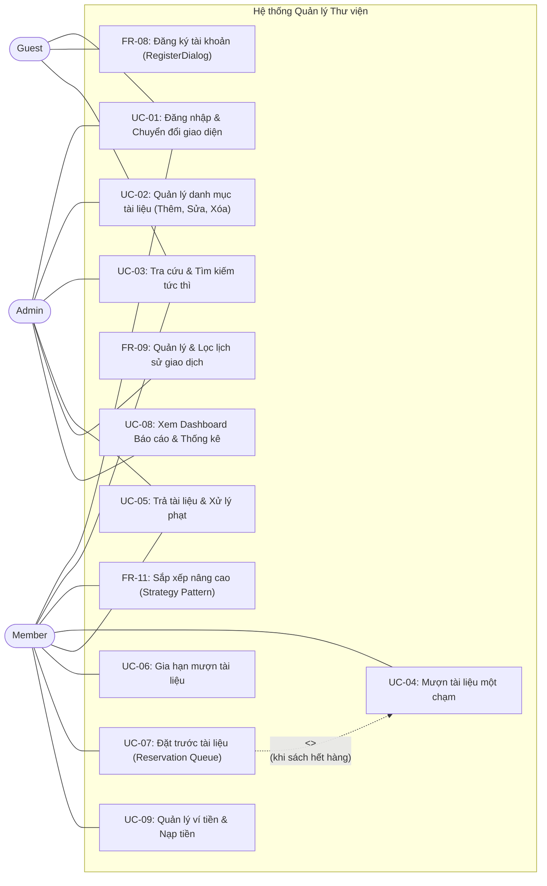
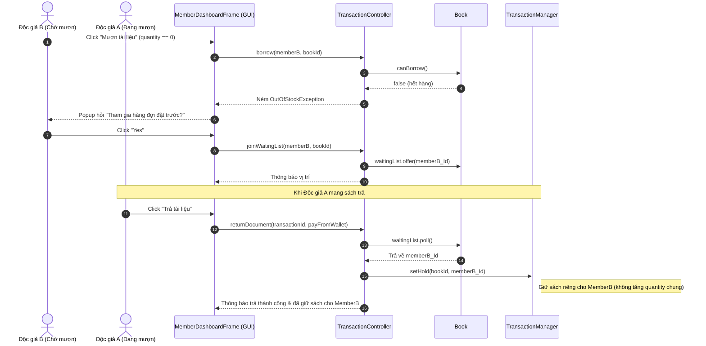
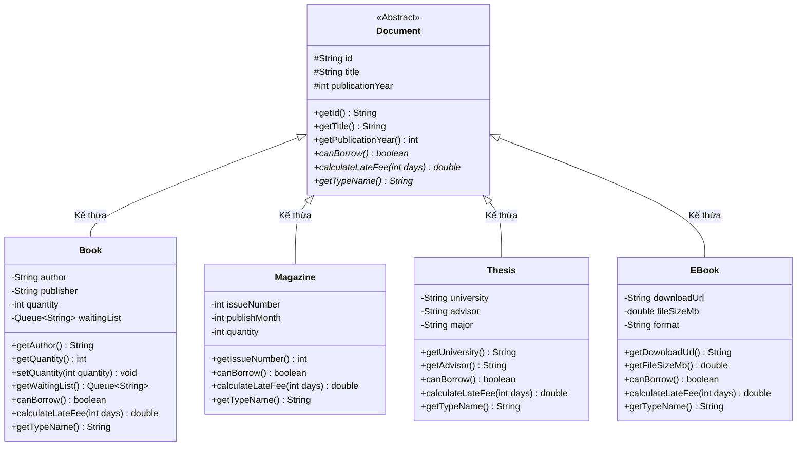
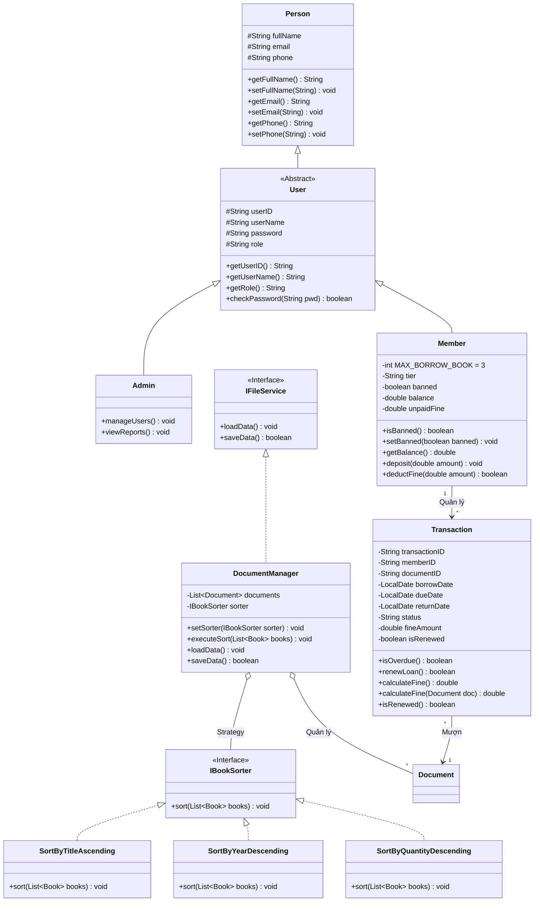

# BÁO CÁO ĐỒ ÁN MÔN HỌC LẬP TRÌNH HƯỚNG ĐỐI TƯỢNG (OOP)
## Đề tài: Hệ thống Quản lý Thư viện (Library Management System – Desktop GUI)
### Nội dung: Tổng hợp Milestone 1, 2, 3 và 4

---

## MỤC LỤC
1. [Milestone 1 – Problem Analysis (Phân tích bài toán)](#milestone-1--problem-analysis-phân-tích-bài-toán)
2. [Milestone 2 – Object-Oriented Analysis (Phân tích Hướng đối tượng)](#milestone-2--object-oriented-analysis-phân-tích-hướng-đối-tượng)
3. [Milestone 3 – UML Design (Thiết kế UML)](#milestone-3--uml-design-thiết-kế-uml)
4. [Milestone 4 – Core Implementation (Cài đặt cốt lõi)](#milestone-4--core-implementation-cài-đặt-cốt-lõi)

---

# MILESTONE 1 – PROBLEM ANALYSIS (Phân tích bài toán)
*(Tương ứng giai đoạn: Mô tả Requirements và Use Cases – Sau chương 1)*

## 1.1. Mô tả bài toán & Mục tiêu hệ thống
Trong hoạt động quản lý thư viện truyền thống (sổ sách thủ công hoặc ứng dụng dòng lệnh đơn giản), việc tra cứu đầu sách, kiểm soát số lượng bản sao, theo dõi hạn trả, tính phí phạt trễ hạn và quản lý các loại học liệu đa dạng (sách in, tạp chí, luận văn, sách điện tử) thường tốn nhiều công sức và dễ sai sót.

Đồ án xây dựng **Hệ thống Quản lý Thư viện (Library Management System)** dưới dạng **ứng dụng Desktop GUI phát triển bằng Java Swing & AWT** theo kiến trúc **MVC (Model - View - Controller)** và lưu trữ dữ liệu bền vững bằng tập tin CSV (`UTF-8`). Hệ thống hướng tới hai mục tiêu song hành:
1. **Về nghiệp vụ:** Tin học hóa trọn vẹn quy trình mượn/trả, gia hạn, đặt trước theo hàng đợi, thu phí phạt qua ví độc giả và thống kê điều hành cho thủ thư trên giao diện đồ họa trực quan.
2. **Về kỹ thuật OOP:** Vận dụng chuẩn mực 4 nguyên lý cốt lõi (**Đóng gói, Kế thừa, Đa hình, Trừu tượng**), **Java Collections Framework**, **Java Stream API**, **Xử lý ngoại lệ** và **Strategy Pattern**.

## 1.2. Các Tác nhân (Actors)
Hệ thống phục vụ 3 nhóm tác nhân thông qua các màn hình giao diện chuyên biệt:
* **Admin (Quản trị viên / Thủ thư):** Đăng nhập vào `AdminDashboardFrame`. Có toàn quyền quản lý danh mục tài liệu (Thêm, Sửa, Xóa), xem và lọc lịch sử giao dịch toàn thư viện, tiếp nhận trả sách, thu tiền phạt và theo dõi báo cáo thống kê (KPI Cards, Top 3 tài liệu mượn nhiều nhất, danh sách nợ quá hạn).
* **Member (Độc giả):** Đăng nhập vào `MemberDashboardFrame`. Có thể tra cứu tài liệu với tìm kiếm tức thì (Live Search), sắp xếp sách theo nhiều tiêu chí, mượn tài liệu một chạm, gia hạn mượn (+7 ngày), đăng ký hàng đợi đặt trước khi hết sách, xem lịch sử mượn cá nhân và nạp tiền vào ví cá nhân.
* **Guest (Khách vãng lai):** Không cần đăng nhập. Có thể mở `GuestCatalogFrame` từ màn hình đăng nhập để xem danh mục công khai và tìm kiếm tài liệu, hoặc mở hộp thoại `RegisterDialog` để đăng ký trở thành `Member`.

## 1.3. Yêu cầu Chức năng (Functional Requirements)

| Mã YC | Tên Chức năng | Mô tả yêu cầu |
| :--- | :--- | :--- |
| **FR-01** | Giao diện Đồ họa (GUI) | Xây dựng bằng Java Swing (`JFrame`, `JPanel`, `JTabbedPane`, `JTable`, `JScrollPane`, `JOptionPane`). |
| **FR-02** | Đăng nhập & Phân quyền | Xác thực `userName`/`password`, điều hướng sang `AdminDashboardFrame` hoặc `MemberDashboardFrame` theo vai trò. |
| **FR-03** | Quản lý Tài liệu (CRUD) | Thủ thư thêm, cập nhật, xóa tài liệu qua Form và bảng `JTable`; kiểm tra dữ liệu nhập và đồng bộ file. |
| **FR-04** | Tìm kiếm Tức thì (Live Search) | Lọc danh sách tài liệu theo thời gian thực khi gõ phím (`DocumentListener`), hỗ trợ tiêu chí: *Tất cả, Tiêu đề, Tác giả, Mã ID* (không phân biệt hoa thường và dấu tiếng Việt). |
| **FR-05** | Mượn Tài liệu Một Chạm | Kiểm tra tài khoản không bị khóa, hạn mức tối đa 3 cuốn đang mượn, không mượn trùng cuốn đang giữ, kiểm tra `canBorrow()`, tạo phiếu mượn hạn 14 ngày và trừ tồn kho. |
| **FR-06** | Trả Tài liệu & Tính Phạt | Tính số ngày quá hạn (`LocalDate`), tính phạt `5.000 VNĐ/ngày`, hỗ trợ trừ trực tiếp từ ví độc giả hoặc ghi nợ, và xử lý hoàn trả kho/hàng đợi. |
| **FR-07** | Lưu trữ File I/O | Tự động nạp dữ liệu từ file CSV (`users-v2.csv`, `documents-v2.csv`, `transactions-v2.csv`, `holds-v2.csv`) khi khởi chạy và đồng bộ lưu ngay khi có thay đổi. |
| **FR-08** | Đăng ký Tài khoản | Khách đăng ký tài khoản `Member` qua `RegisterDialog`, kiểm tra định dạng và trùng lặp tên đăng nhập. |
| **FR-09** | Quản lý & Lọc Giao dịch | Hiển thị lịch sử giao dịch trên `JTable`, hỗ trợ lọc theo trạng thái: *Tất cả, Đang mượn, Đã trả, Quá hạn*. |
| **FR-10** | Gia hạn Mượn (Renew Loan) | Gia hạn thêm 7 ngày cho giao dịch đang mượn với 3 điều kiện: chưa từng gia hạn (`isRenewed == false`), chưa quá hạn và không có người chờ trong hàng đợi. |
| **FR-11** | Sắp xếp Nâng cao | Sắp xếp sách theo 3 tiêu chí (*Tên sách A-Z, Năm xuất bản mới nhất, Số lượng tồn kho nhiều nhất*) áp dụng **Strategy Pattern** (`IBookSorter`). |
| **FR-12** | Hàng đợi Đặt trước (FIFO) | Khi sách hết bản sao (`quantity == 0`), cho phép độc giả đăng ký vào `Queue` (`waitingList`). Khi có người trả, giữ sách riêng cho người đứng đầu hàng đợi. |
| **FR-13** | Báo cáo & Thống kê Dashboard | Thẻ KPI (Tổng tài liệu, Đang mượn, Quá hạn, Doanh thu phạt) + bảng Top 3 tài liệu mượn nhiều nhất + danh sách quá hạn bằng **Java Stream API**. |
| **FR-14** | Đa dạng hóa Tài liệu | Quản lý 4 loại ấn phẩm kế thừa `Document`: `Book`, `Magazine`, `Thesis` (chỉ đọc tại chỗ), `EBook` (không giới hạn số lượng, phí trễ = 0). |
| **FR-15** | Ví tiền & Khóa tài khoản | Quản lý `balance` và `unpaidFine` trên `Member`; nợ phạt vượt quá `50.000 VNĐ` tự động khóa (`banned = true`), nạp đủ tiền trả nợ sẽ tự mở khóa. |

## 1.4. Yêu cầu Phi chức năng (Non-Functional Requirements)
1. **Giao diện & Trải nghiệm (UI/UX):** Áp dụng `Nimbus Look & Feel`, hỗ trợ phím tắt (`Enter` để xác nhận, `Esc` để đóng hộp thoại).
2. **Hiệu năng:** Tìm kiếm tức thì và sắp xếp trên bộ nhớ phản hồi nhanh, không gây treo giao diện người dùng.
3. **Toàn vẹn dữ liệu:** Đọc/ghi tập tin chuẩn `UTF-8`, có cơ chế tìm đường dẫn linh hoạt và sao lưu ngay sau các thao tác thay đổi dữ liệu.
4. **Kiểm soát ngoại lệ:** Mọi lỗi nhập liệu hoặc vi phạm nghiệp vụ đều được bắt và hiển thị thông báo tiếng Việt thân thiện qua `JOptionPane`, không làm dừng chương trình đột ngột.
5. **Khả năng mở rộng:** Thiết kế hướng đối tượng tuân thủ nguyên lý Đóng/Mở (OCP), dễ dàng bổ sung loại tài liệu hoặc chiến lược sắp xếp mới.

## 1.5. Sơ đồ & Đặc tả Use Case (UC-01 đến UC-09)

**Tóm tắt 9 Use Case cốt lõi:**
* **UC-01 – Đăng nhập & Chuyển đổi Giao diện (`Admin`, `Member`, `Guest`):** Nhập `userName`/`password` trên `LoginFrame`; xác thực qua `UserManager` để mở `AdminDashboardFrame` hoặc `MemberDashboardFrame`; khách có thể mở `GuestCatalogFrame` hoặc `RegisterDialog`.
* **UC-02 – Quản lý Danh mục Tài liệu (`Admin`):** Chọn loại tài liệu (`Book`, `Magazine`, `Thesis`, `EBook`), nhập thông tin trên Form để Thêm mới, chọn dòng trên `JTable` để Cập nhật hoặc Xóa (có hộp thoại xác nhận) và tự động lưu xuống file CSV.
* **UC-03 – Tra cứu & Tìm kiếm tức thì (`Guest`, `Member`, `Admin`):** Chọn tiêu chí tìm kiếm và gõ từ khóa vào ô tìm kiếm; `DocumentListener` tự động lọc và cập nhật `JTable` ngay lập tức.
* **UC-04 – Mượn Tài liệu Một Chạm (`Member`):** Kiểm tra `banned == false`, số sách đang mượn `< 3`, không đang giữ bản sao khác của tài liệu đó và `canBorrow()`. Nếu là `Thesis` thì từ chối (chỉ đọc tại chỗ); nếu `Book` hết hàng (`quantity == 0`) thì gợi ý chuyển sang **UC-07**; hợp lệ thì tạo `Transaction` hạn 14 ngày và giảm tồn kho.
* **UC-05 – Trả Tài liệu & Xử lý Phạt (`Admin`, `Member`):** Tính ngày trễ hạn và tiền phạt (`5.000 VNĐ/ngày` đối với `Book`/`Magazine`). Cho phép trừ ví độc giả hoặc ghi nợ vào `unpaidFine` (nếu nợ `> 50.000 VNĐ` thì tự khóa tài khoản). Khi trả `Book`, kiểm tra `waitingList.poll()` để giữ sách riêng cho người đầu hàng đợi, nếu không có ai chờ mới tăng `quantity + 1`.
* **UC-06 – Gia hạn Mượn Tài liệu (`Member`):** Kiểm tra đủ 3 điều kiện: phiếu ở trạng thái `BORROWED` và `isRenewed == false`, chưa quá hạn (`!isOverdue()`), và sách không có người chờ trong `waitingList`. Nếu đạt thì cộng thêm `7 ngày` vào `dueDate` và đánh dấu `isRenewed = true`.
* **UC-07 – Đặt trước Tài liệu (`Member`):** Khi sách hết tồn kho, độc giả xác nhận tham gia hàng đợi `waitingList.offer(memberID)` (chặn đăng ký trùng) và nhận số thứ tự ưu tiên theo FIFO.
* **UC-08 – Xem Dashboard Báo cáo & Thống kê (`Admin`):** Hiển thị 4 thẻ KPI (Tổng đầu sách, Đang mượn, Quá hạn, Doanh thu phạt) cùng bảng Top 3 tài liệu được mượn nhiều nhất và danh sách quá hạn tính bằng Java Stream API.
* **UC-09 – Quản lý Ví tiền & Nạp tiền (`Member`):** Xem số dư `balance`, nợ phạt `unpaidFine`, trạng thái tài khoản; nạp tiền dương vào ví; nếu đang bị khóa mà nạp đủ trả nợ thì tự động khấu trừ hết nợ và mở khóa (`banned = false`).

---

# MILESTONE 2 – OBJECT-ORIENTED ANALYSIS (Phân tích Hướng đối tượng)
*(Tương ứng giai đoạn: Xác định Objects/Classes và Trách nhiệm – Sau chương 3)*

## 2.1. Phương pháp xác định Đối tượng và Lớp
Từ bản đặc tả yêu cầu ở Milestone 1, hệ thống áp dụng kỹ thuật phân tích danh từ/động từ kết hợp mô hình **MVC (Model – View – Controller)** để phân tách rõ ràng giữa **Thực thể dữ liệu**, **Dịch vụ nghiệp vụ/Lưu trữ**, **Bộ điều phối sự kiện** và **Giao diện người dùng**:
1. **Nhóm Thực thể miền bài toán (Domain Entities – `model`):** Đại diện cho các đối tượng cốt lõi như con người (`Person`, `User`, `Admin`, `Member`), ấn phẩm thư viện (`Document`, `Book`, `Magazine`, `Thesis`, `EBook`) và giao dịch (`Transaction`).
2. **Nhóm Giao diện hợp đồng & Chiến lược (`interfaces`, `strategy`):** Tách các hành vi có thể thay đổi độc lập (thuật toán sắp xếp, chuẩn đọc/ghi file) thành interface `IBookSorter`, `IFileService` và các lớp chiến lược cụ thể.
3. **Nhóm Quản lý & Xử lý dữ liệu (`manager`):** Quản lý tập hợp đối tượng trong bộ nhớ, tìm kiếm, thống kê và đồng bộ file (`DocumentManager`, `UserManager`, `TransactionManager`).
4. **Nhóm Điều phối nghiệp vụ (`controller`):** Tiếp nhận tương tác từ GUI, kiểm tra quy tắc nghiệp vụ liên quan nhiều đối tượng và cập nhật trạng thái (`LoginController`, `DocumentController`, `TransactionController`, `WalletController`).
5. **Nhóm Giao diện & Tiện ích (`view`, `util`, `main`):** Hiển thị cửa sổ Swing và cung cấp các hàm dùng chung.

## 2.2. Bảng xác định Lớp và Trách nhiệm (Class–Responsibility Table)

### A. Tầng Thực thể (`model`)
| Lớp / Phân loại | Trách nhiệm chính (Responsibilities) |
| :--- | :--- |
| **`Person`** *(Class)* | Lưu trữ thông tin cá nhân chung (`fullName`, `email`, `phone`) và kiểm tra hợp lệ đầu vào qua `Validator`. |
| **`User`** *(Abstract Class)* | Kế thừa `Person`; lưu thông tin tài khoản (`userID`, `userName`, `password`, `role`) và cung cấp kiểm tra mật khẩu `checkPassword(pwd)`. |
| **`Admin`** *(Class)* | Kế thừa `User` với vai trò `"ADMIN"`; đại diện cho thủ thư thực hiện nghiệp vụ quản trị và báo cáo (`manageUsers()`, `viewReports()`). |
| **`Member`** *(Class)* | Kế thừa `User` với vai trò `"MEMBER"`; quản lý hạn mức mượn (`MAX_BORROW_BOOK = 3`), hạng thành viên (`tier`), trạng thái khóa (`banned`), ví tiền (`balance`), nợ phạt (`unpaidFine`), nạp tiền (`deposit`) và trừ phạt (`deductFine`). |
| **`Document`** *(Abstract Class)* | Khái quát hóa ấn phẩm (`id`, `title`, `publicationYear`); định nghĩa hợp đồng đa hình `canBorrow()`, `calculateLateFee(int days)`, `getTypeName()`. |
| **`Book`** *(Class)* | Kế thừa `Document`; quản lý `author`, `publisher`, `quantity`, hàng đợi đặt trước FIFO `Queue<String> waitingList`; cho mượn khi `quantity > 0`, phạt `5.000 VNĐ/ngày`. |
| **`Magazine`** *(Class)* | Kế thừa `Document`; quản lý `issueNumber`, `publishMonth`, `quantity`; cho mượn khi `quantity > 0`, phạt `5.000 VNĐ/ngày`. |
| **`Thesis`** *(Class)* | Kế thừa `Document`; quản lý `university`, `advisor`, `major`; ghi đè `canBorrow()` luôn trả về `false` (chỉ đọc tại chỗ). |
| **`EBook`** *(Class)* | Kế thừa `Document`; quản lý `downloadUrl`, `fileSizeMb`, `format`; ghi đè `canBorrow()` luôn là `true` và `calculateLateFee()` là `0.0`. |
| **`Transaction`** *(Class)* | Lưu phiếu mượn (`transactionID`, `memberID`, `documentID`, `borrowDate`, `dueDate`, `returnDate`, `status`, `fineAmount`, `isRenewed`); xử lý `isOverdue()`, `renewLoan()` (+7 ngày) và `calculateFine()`. |

### B. Tầng Giao diện Hợp đồng (`interfaces`) & Chiến lược (`strategy`)
| Lớp / Interface | Trách nhiệm chính (Responsibilities) |
| :--- | :--- |
| **`IBookSorter`** *(Interface)* | Định nghĩa phương thức `sort(List<Book> books)` cho Strategy Pattern sắp xếp sách. |
| **`IFileService`** *(Interface)* | Định nghĩa chuẩn `loadData()` và `saveData()` cho mọi lớp quản lý có lưu trữ file. |
| **`SortByTitleAscending`** | Cài đặt `IBookSorter`: sắp xếp sách theo tiêu đề A $\rightarrow$ Z không phân biệt hoa thường. |
| **`SortByYearDescending`** | Cài đặt `IBookSorter`: sắp xếp sách theo năm xuất bản từ mới nhất đến cũ nhất. |
| **`SortByQuantityDescending`** | Cài đặt `IBookSorter`: sắp xếp sách theo số lượng tồn kho giảm dần. |

### C. Tầng Quản lý Dữ liệu (`manager`)
| Lớp | Trách nhiệm chính (Responsibilities) |
| :--- | :--- |
| **`DocumentManager`** | Quản lý `List<Document>`, thực hiện CRUD tài liệu, tìm kiếm Live Search (`searchDocuments`), thực thi sắp xếp qua `IBookSorter` (`setSorter`, `executeSort`), đọc/ghi `data/documents-v2.csv`. |
| **`UserManager`** | Quản lý `List<User>`, xác thực đăng nhập (`authenticate`), đăng ký độc giả (`registerMember`), sinh mã `MEMxxx`, kiểm tra trùng ID/username, đọc/ghi `data/users-v2.csv`. |
| **`TransactionManager`** | Quản lý `List<Transaction>` và bản đồ giữ sách `Map<String, String> holds`; lọc trạng thái (`filterByStatus`), thống kê Stream API (`countBorrowed`, `countOverdue`, `totalCollectedFine`, `topBorrowedDocuments`), đọc/ghi `data/transactions-v2.csv` và `data/holds-v2.csv`. |

### D. Tầng Điều phối (`controller`), Giao diện (`view`), Tiện ích (`util`) & Khởi chạy (`main`)
| Tầng | Lớp | Trách nhiệm chính (Responsibilities) |
| :--- | :--- | :--- |
| **`controller`** | `LoginController` | Xác thực đăng nhập và kiểm tra hợp lệ khi đăng ký tài khoản mới. |
| **`controller`** | `DocumentController` | Điều phối Thêm/Sửa/Xóa, tìm kiếm, sắp xếp sách và lưu file ngay lập tức. |
| **`controller`** | `TransactionController` | Điều phối toàn bộ luồng Mượn (kiểm tra `banned`, hạn mức 3, trùng sách, `OutOfStockException`), Đặt trước FIFO, Trả sách & giữ chỗ, Gia hạn mượn. |
| **`controller`** | `WalletController` | Điều phối nạp tiền vào ví (`deposit`) và thu nợ phạt tích lũy (`collectUnpaidFine`). |
| **`view`** | `LoginFrame`, `RegisterDialog`, `GuestCatalogFrame`, `AdminDashboardFrame`, `MemberDashboardFrame`, `UiUtil` | Hiển thị giao diện Swing, gắn `DocumentListener` cho Live Search, bắt ngoại lệ hiển thị `JOptionPane`, hỗ trợ xuất báo cáo thống kê. |
| **`util`** | `FileUtil`, `DateUtil`, `FormatUtil`, `TextUtil`, `Validator` | Đọc/ghi CSV chuẩn UTF-8, định dạng ngày `dd/MM/yyyy`, định dạng tiền `VNĐ`, chuẩn hóa chuỗi không dấu và kiểm tra hợp lệ dữ liệu. |
| **`main`** | `Main` | Áp dụng `Nimbus Look & Feel`, nạp dữ liệu từ file (khởi tạo dữ liệu mẫu lần đầu) và mở `LoginFrame`. |

## 2.3. Cộng tác giữa các Đối tượng (Object Collaboration)
Minh họa luồng cộng tác điển hình khi **Độc giả B đặt trước sách hết hàng và được giữ sách khi Độc giả A trả sách**:

---

# MILESTONE 3 – UML DESIGN (Thiết kế UML)
*(Tương ứng giai đoạn: Class Diagram, Relationships, Inheritance – Sau chương 6)*

## 3.1. Thiết kế Kế thừa & Đa hình (Inheritance & Polymorphism)

### 1. Cây phân cấp Người dùng (`Person` $\leftarrow$ `User` $\leftarrow$ `Admin`, `Member`)
* `Person` đóng gói các thuộc tính nhân thân cơ bản (`fullName`, `email`, `phone`).
* `User` là lớp trừu tượng (`abstract`) mở rộng `Person`, bổ sung thông tin xác thực (`userID`, `userName`, `password`, `role`).
* `Admin` và `Member` kế thừa `User`, tái sử dụng toàn bộ cơ chế kiểm tra mật khẩu (`checkPassword`) và mở rộng hành vi riêng cho từng vai trò (`manageUsers()`, `viewReports()` ở `Admin`; `deposit()`, `deductFine()`, quản lý ví và khóa tài khoản ở `Member`).

### 2. Cây phân cấp Tài liệu (`Document` $\leftarrow$ `Book`, `Magazine`, `Thesis`, `EBook`)
* `Document` là lớp trừu tượng (`abstract`) định nghĩa khung chung (`id`, `title`, `publicationYear`) và 3 phương thức trừu tượng để các lớp con thể hiện **Đa hình**:

| Lớp con | `canBorrow()` | `calculateLateFee(int days)` | `getTypeName()` |
| :--- | :--- | :--- | :--- |
| **`Book`** | `quantity > 0` | `days * 5.000 VNĐ` (nếu `days > 0`) | `"Sách"` |
| **`Magazine`** | `quantity > 0` | `days * 5.000 VNĐ` (nếu `days > 0`) | `"Tạp chí"` |
| **`Thesis`** | Luôn trả về `false` *(chỉ đọc tại chỗ)* | `0.0 VNĐ` | `"Luận văn"` |
| **`EBook`** | Luôn trả về `true` *(tài nguyên số không giới hạn)* | `0.0 VNĐ` *(hết hạn tự ngắt quyền truy cập)* | `"E-Book"` |

## 3.2. Thiết kế Các Mối quan hệ UML (Relationships)
* **Kế thừa (Generalization / Inheritance `---|>`):** `User` kế thừa `Person`; `Admin`, `Member` kế thừa `User`; `Book`, `Magazine`, `Thesis`, `EBook` kế thừa `Document`.
* **Hiện thực hóa giao diện (Realization `..|>`):**
  * `SortByTitleAscending`, `SortByYearDescending`, `SortByQuantityDescending` cài đặt `IBookSorter`.
  * `DocumentManager`, `UserManager`, `TransactionManager` cài đặt `IFileService`.
* **Kết tập (Aggregation `o--`) & Kết hợp (Association `-->`):**
  * `DocumentManager` `o--` `IBookSorter` (Strategy Composition: có thể thay đổi chiến lược sắp xếp động tại runtime qua `setSorter(...)`).
  * `DocumentManager` `o--` `*` `Document`; `UserManager` `o--` `*` `User`; `TransactionManager` `o--` `*` `Transaction`.
  * `Member` `1` $\rightarrow$ `*` `Transaction` (một độc giả sở hữu nhiều phiếu mượn).
  * `Transaction` `*` $\rightarrow$ `1` `Document` (mỗi phiếu mượn gắn với một tài liệu).
* **Phụ thuộc (Dependency `..>`):** Các lớp `Controller` và `View` sử dụng tầng `Manager` và các lớp `Util` (`Validator`, `DateUtil`, `FormatUtil`, `TextUtil`, `FileUtil`).

## 3.3. Sơ đồ Lớp (Class Diagrams)

### A. Sơ đồ Lớp Phân cấp Tài liệu (Mục 5.2 SRS)

### B. Sơ đồ Lớp Người dùng, Giao dịch & Strategy Pattern (Mục 5.3 & 5.5 SRS)

---

# MILESTONE 4 – CORE IMPLEMENTATION (Cài đặt cốt lõi)
*(Tương ứng giai đoạn: Java Classes + Collections + Exception Handling – Sau chương 8)*

## 4.1. Kiến trúc Gói mã nguồn (Package Organization)
Toàn bộ hệ thống được tổ chức thành **8 package mã nguồn** (cùng thư mục `data`) với tổng cộng **34 file `.java`** tách biệt rõ vai trò MVC (biên dịch sạch với `javac` không có lỗi):
* `model` (10 lớp): `Person`, `User`, `Admin`, `Member`, `Document`, `Book`, `Magazine`, `Thesis`, `EBook`, `Transaction`.
* `interfaces` (2 giao diện): `IBookSorter`, `IFileService`.
* `strategy` (3 lớp): `SortByTitleAscending`, `SortByYearDescending`, `SortByQuantityDescending`.
* `manager` (3 lớp): `DocumentManager`, `UserManager`, `TransactionManager`.
* `controller` (4 lớp): `LoginController`, `DocumentController`, `TransactionController`, `WalletController`.
* `view` (6 lớp): `LoginFrame`, `RegisterDialog`, `GuestCatalogFrame`, `AdminDashboardFrame`, `MemberDashboardFrame`, `UiUtil`.
* `util` (5 lớp): `FileUtil`, `DateUtil`, `FormatUtil`, `TextUtil`, `Validator`.
* `main` (1 lớp): `Main`.
* `data`: Lưu dữ liệu vận hành (`documents-v2.csv`, `users-v2.csv`, `transactions-v2.csv`, và sinh thêm `holds-v2.csv` khi có giữ chỗ hàng đợi).

## 4.2. Cài đặt Java Classes & Nguyên lý OOP
1. **Đóng gói (Encapsulation):** Toàn bộ các trường dữ liệu nhạy cảm (`balance`, `unpaidFine`, `quantity`, `dueDate`, `status`...) được bảo vệ bằng `private`/`protected`. Mọi thay đổi qua `setter` đều đi qua [`Validator.java`](../src/util/Validator.java) để chuẩn hóa `.trim()`, `.toUpperCase()` và kiểm tra biên giá trị trước khi gán.
2. **Đa hình (Polymorphism) & Nạp chồng (Overloading):**
   * Trong `Document`, các lớp con `Book`, `Magazine`, `Thesis`, `EBook` ghi đè `canBorrow()`, `calculateLateFee(int days)`, `getTypeName()`. Trong `Transaction.java` có sẵn 2 hàm nạp chồng: `calculateFine()` và `calculateFine(Document doc)` (gọi đa hình `doc.calculateLateFee(...)`).
   * Trong `DocumentManager`, `setSorter(IBookSorter)` cho phép chuyển đổi thuật toán sắp xếp tức thì mà không cần `switch-case`.

## 4.3. Ứng dụng Java Collections Framework & Stream API
Hệ thống sử dụng đa dạng cấu trúc dữ liệu trong `java.util` phù hợp cho từng bài toán cụ thể:

| Cấu trúc / API | Vị trí cài đặt | Mục đích & Lý do lựa chọn |
| :--- | :--- | :--- |
| **`ArrayList<T>`** | `DocumentManager` (`List<Document>`), `UserManager` (`List<User>`), `TransactionManager` (`List<Transaction>`) | Lưu trữ động toàn bộ thực thể trong bộ nhớ, hỗ trợ truy xuất nhanh, duyệt tuần tự và lọc danh sách. |
| **`Collections.unmodifiableList`** | `UserManager.getUsers()` | Trả về bản sao chỉ đọc để bảo vệ danh sách nội bộ khỏi bị sửa/xóa trái phép từ bên ngoài. |
| **`Queue<String>` (`LinkedList<>`)** | `Book.waitingList` | Cài đặt **Hàng đợi đặt trước FIFO (First-In, First-Out)**: `offer()` khi độc giả đăng ký chờ sách hết hàng, `poll()` lấy người đăng ký đầu tiên khi có người trả sách (`TransactionController`). |
| **`Map<String, String>` (`LinkedHashMap<>`)** | `TransactionManager.holds` | Ánh xạ `documentID -> memberID` để giữ riêng bản sao sách vừa được trả cho người đứng đầu hàng đợi, đồng thời lưu/đọc xuống `data/holds-v2.csv`. |
| **`Map<String, Long>` (`LinkedHashMap`)** | `TransactionManager.topBorrowedDocuments(int limit)` | Dùng kết hợp `Collectors.groupingBy(..., Collectors.counting())` để thống kê số lượt mượn theo mã tài liệu và giữ nguyên thứ tự giảm dần của Top 3. |
| **`Set<String>` (`LinkedHashSet`)** | `TransactionManager.overdueMemberIds()` | Thu thập tập mã độc giả đang có ít nhất một giao dịch quá hạn, tự động loại bỏ trùng lặp mã độc giả. |
| **`Java Stream API`** | `DocumentManager`, `TransactionManager` | Xử lý tìm kiếm Live Search (`filter`), tách danh sách `Book` (`filter` + `map`), đếm lượt mượn đang mở (`countBorrowed`), đếm quá hạn (`countOverdue`) và tính tổng tiền phạt (`mapToDouble().sum()`). |

## 4.4. Cơ chế Xử lý Ngoại lệ (Exception Handling)
Hệ thống thiết kế cơ chế bắt và xử lý ngoại lệ đa tầng theo đúng yêu cầu Mục 7.4 của SRS để đảm bảo chương trình **không bao giờ bị crash** khi nhập sai dữ liệu hoặc vi phạm nghiệp vụ:

1. **Ngoại lệ kiểm tra đầu vào tại `Validator` & `Model` (`IllegalArgumentException`):**
   * `Validator.requireText`, `requireEmail`, `requirePhone`, `requireUrl`, `requirePositive`, `requireNonNegative`, `requireRange`, `parseInt`, `parsePositiveDouble` đều bắt lỗi kiểu dữ liệu (như `NumberFormatException` khi người dùng nhập chữ vào ô năm xuất bản/số lượng/tiền nạp) và chuyển thành `IllegalArgumentException` với thông điệp tiếng Việt rõ ràng.
   * `DateUtil.parse` bắt `DateTimeParseException` để hỗ trợ cả định dạng `dd/MM/yyyy` lẫn ISO `yyyy-MM-dd` trước khi ném thông báo lỗi định dạng.

2. **Ngoại lệ kiểm soát quy tắc nghiệp vụ tại `Controller` (`IllegalStateException` & Custom Exception):**
   * `LoginController`: Ném `IllegalArgumentException` khi bỏ trống, sai mật khẩu, mật khẩu xác nhận không khớp hoặc trùng tên đăng nhập.
   * `TransactionController`:
     * Định nghĩa ngoại lệ riêng **`OutOfStockException`** (kế thừa `RuntimeException`) khi `Book` hết bản sao để tầng `View` phân biệt riêng luồng gợi ý tham gia **Hàng đợi đặt trước** với các lỗi từ chối mượn thông thường.
     * Ném `IllegalStateException` khi tài khoản bị khóa (`banned`), vượt hạn mức 3 cuốn, mượn trùng sách đang giữ, mượn `Thesis`, gia hạn quá 1 lần, gia hạn khi quá hạn hoặc gia hạn sách đang có người đặt trước.

3. **Xử lý ngoại lệ File I/O tại `util` & `manager` (`IOException`, `try-with-resources`):**
   * `FileUtil.readLines` và `FileUtil.writeLines` dùng `try-with-resources` (`BufferedReader`, `BufferedWriter`) với `StandardCharsets.UTF_8`, bắt `IOException` để log lỗi an toàn mà không làm treo ứng dụng; nếu file chưa tồn tại thì trả về danh sách rỗng để `Main` khởi tạo dữ liệu mẫu.
   * Khi phân tích từng dòng CSV trong `DocumentManager.loadData()`, `UserManager.loadData()`, `TransactionManager.loadData()`, mỗi dòng được bọc trong khối `try-catch (RuntimeException)` để bỏ qua dòng dữ liệu lỗi cục bộ mà vẫn nạp trọn vẹn phần dữ liệu hợp lệ còn lại.

4. **Bắt ngoại lệ tại tầng Giao diện Swing (`view`):**
   * Toàn bộ các sự kiện nhấn nút trên `LoginFrame`, `RegisterDialog`, `AdminDashboardFrame`, `MemberDashboardFrame` đều bọc trong `try-catch`:
     * Bắt riêng `TransactionController.OutOfStockException` để mở hộp thoại `JOptionPane.showConfirmDialog` hỏi xác nhận đặt trước.
     * Bắt `RuntimeException` chung để hiển thị thông báo lỗi cụ thể (`ex.getMessage()`) qua `JOptionPane.showMessageDialog(..., JOptionPane.ERROR_MESSAGE)`, giữ nguyên cửa sổ làm việc cho người dùng sửa lại dữ liệu.
