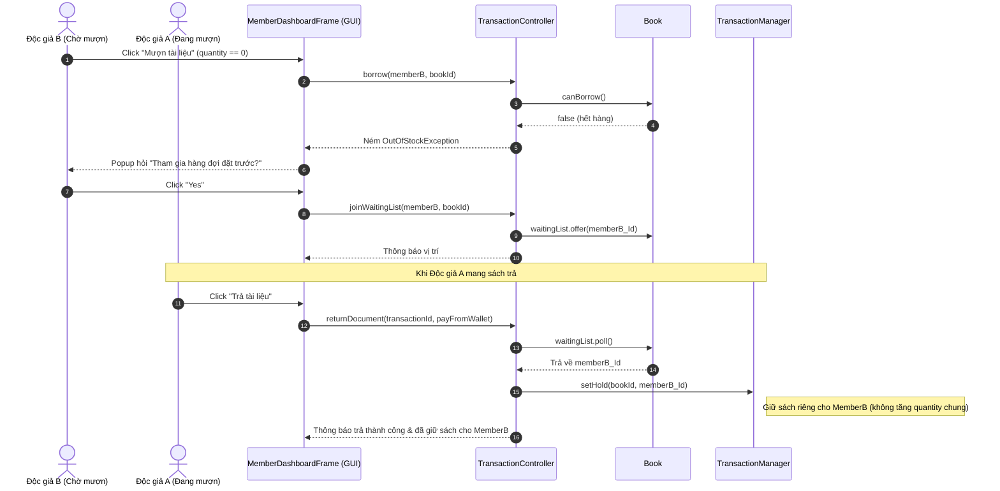

# BÁO CÁO ĐỒ ÁN MÔN HỌC LẬP TRÌNH HƯỚNG ĐỐI TƯỢNG (OOP)
## Đề tài: Hệ thống Quản lý Thư viện (Library Management System – Desktop GUI)

---

# MILESTONE 2 – OBJECT-ORIENTED ANALYSIS (Phân tích Hướng đối tượng)
*(Tương ứng giai đoạn: Xác định Objects/Classes và Trách nhiệm – Sau chương 3)*

## 2.1. Phương pháp xác định Đối tượng và Lớp
Từ bản đặc tả yêu cầu ở Milestone 1, hệ thống áp dụng kỹ thuật phân tích danh từ/động từ kết hợp mô hình **MVC (Model – View – Controller)** để phân tách rõ ràng giữa **Thực thể dữ liệu**, **Dịch vụ nghiệp vụ/Lưu trữ**, **Bộ điều phối sự kiện** và **Giao diện người dùng**:
1. **Nhóm Thực thể miền bài toán (Domain Entities – `model`):** Đại diện cho các đối tượng cốt lõi như con người (`Person`, `User`, `Admin`, `Member`), ấn phẩm thư viện (`Document`, `Book`, `Magazine`, `Thesis`, `EBook`) và giao dịch (`Transaction`).
2. **Nhóm Giao diện hợp đồng & Chiến lược (`interfaces`, `strategy`):** Tách các hành vi có thể thay đổi độc lập (thuật toán sắp xếp, chuẩn đọc/ghi file) thành interface `IBookSorter`, `IFileService` và các lớp chiến lược cụ thể.
3. **Nhóm Quản lý & Xử lý dữ liệu (`manager`):** Quản lý tập hợp đối tượng trong bộ nhớ, tìm kiếm, thống kê và đồng bộ file (`DocumentManager`, `UserManager`, `TransactionManager`).
4. **Nhóm Điều phối nghiệp vụ (`controller`):** Tiếp nhận tương tác từ GUI, kiểm tra quy tắc nghiệp vụ liên quan nhiều đối tượng và cập nhật trạng thái (`LoginController`, `DocumentController`, `TransactionController`, `WalletController`).
5. **Nhóm Giao diện & Tiện ích (`view`, `util`, `main`):** Hiển thị cửa sổ Swing và cung cấp các hàm dùng chung.

## 2.2. Bảng xác định Lớp và Trách nhiệm (Class–Responsibility Table)

### A. Tầng Thực thể (`model`)
| Lớp / Phân loại | Trách nhiệm chính (Responsibilities) |
| :--- | :--- |
| **`Person`** *(Class)* | Lưu trữ thông tin cá nhân chung (`fullName`, `email`, `phone`) và kiểm tra hợp lệ đầu vào qua `Validator`. |
| **`User`** *(Abstract Class)* | Kế thừa `Person`; lưu thông tin tài khoản (`userID`, `userName`, `password`, `role`) và cung cấp kiểm tra mật khẩu `checkPassword(pwd)`. |
| **`Admin`** *(Class)* | Kế thừa `User` với vai trò `"ADMIN"`; đại diện cho thủ thư thực hiện nghiệp vụ quản trị và báo cáo (`manageUsers()`, `viewReports()`). |
| **`Member`** *(Class)* | Kế thừa `User` với vai trò `"MEMBER"`; quản lý hạn mức mượn (`MAX_BORROW_BOOK = 3`), hạng thành viên (`tier`), trạng thái khóa (`banned`), ví tiền (`balance`), nợ phạt (`unpaidFine`), nạp tiền (`deposit`) và trừ phạt (`deductFine`). |
| **`Document`** *(Abstract Class)* | Khái quát hóa ấn phẩm (`id`, `title`, `publicationYear`); định nghĩa hợp đồng đa hình `canBorrow()`, `calculateLateFee(int days)`, `getTypeName()`. |
| **`Book`** *(Class)* | Kế thừa `Document`; quản lý `author`, `publisher`, `quantity`, hàng đợi đặt trước FIFO `Queue<String> waitingList`; cho mượn khi `quantity > 0`, phạt `5.000 VNĐ/ngày`. |
| **`Magazine`** *(Class)* | Kế thừa `Document`; quản lý `issueNumber`, `publishMonth`, `quantity`; cho mượn khi `quantity > 0`, phạt `5.000 VNĐ/ngày`. |
| **`Thesis`** *(Class)* | Kế thừa `Document`; quản lý `university`, `advisor`, `major`; ghi đè `canBorrow()` luôn trả về `false` (chỉ đọc tại chỗ). |
| **`EBook`** *(Class)* | Kế thừa `Document`; quản lý `downloadUrl`, `fileSizeMb`, `format`; ghi đè `canBorrow()` luôn là `true` và `calculateLateFee()` là `0.0`. |
| **`Transaction`** *(Class)* | Lưu phiếu mượn (`transactionID`, `memberID`, `documentID`, `borrowDate`, `dueDate`, `returnDate`, `status`, `fineAmount`, `isRenewed`); xử lý `isOverdue()`, `renewLoan()` (+7 ngày) và `calculateFine()`. |

### B. Tầng Giao diện Hợp đồng (`interfaces`) & Chiến lược (`strategy`)
| Lớp / Interface | Trách nhiệm chính (Responsibilities) |
| :--- | :--- |
| **`IBookSorter`** *(Interface)* | Định nghĩa phương thức `sort(List<Book> books)` cho Strategy Pattern sắp xếp sách. |
| **`IFileService`** *(Interface)* | Định nghĩa chuẩn `loadData()` và `saveData()` cho mọi lớp quản lý có lưu trữ file. |
| **`SortByTitleAscending`** | Cài đặt `IBookSorter`: sắp xếp sách theo tiêu đề A $\rightarrow$ Z không phân biệt hoa thường. |
| **`SortByYearDescending`** | Cài đặt `IBookSorter`: sắp xếp sách theo năm xuất bản từ mới nhất đến cũ nhất. |
| **`SortByQuantityDescending`** | Cài đặt `IBookSorter`: sắp xếp sách theo số lượng tồn kho giảm dần. |

### C. Tầng Quản lý Dữ liệu (`manager`)
| Lớp | Trách nhiệm chính (Responsibilities) |
| :--- | :--- |
| **`DocumentManager`** | Quản lý `List<Document>`, thực hiện CRUD tài liệu, tìm kiếm Live Search (`searchDocuments`), thực thi sắp xếp qua `IBookSorter` (`setSorter`, `executeSort`), đọc/ghi `data/documents-v2.csv`. |
| **`UserManager`** | Quản lý `List<User>`, xác thực đăng nhập (`authenticate`), đăng ký độc giả (`registerMember`), sinh mã `MEMxxx`, kiểm tra trùng ID/username, đọc/ghi `data/users-v2.csv`. |
| **`TransactionManager`** | Quản lý `List<Transaction>` và bản đồ giữ sách `Map<String, String> holds`; lọc trạng thái (`filterByStatus`), thống kê Stream API (`countBorrowed`, `countOverdue`, `totalCollectedFine`, `topBorrowedDocuments`), đọc/ghi `data/transactions-v2.csv` và `data/holds-v2.csv`. |

### D. Tầng Điều phối (`controller`), Giao diện (`view`), Tiện ích (`util`) & Khởi chạy (`main`)
| Tầng | Lớp | Trách nhiệm chính (Responsibilities) |
| :--- | :--- | :--- |
| **`controller`** | `LoginController` | Xác thực đăng nhập và kiểm tra hợp lệ khi đăng ký tài khoản mới. |
| **`controller`** | `DocumentController` | Điều phối Thêm/Sửa/Xóa, tìm kiếm, sắp xếp sách và lưu file ngay lập tức. |
| **`controller`** | `TransactionController` | Điều phối toàn bộ luồng Mượn (kiểm tra `banned`, hạn mức 3, trùng sách, `OutOfStockException`), Đặt trước FIFO, Trả sách & giữ chỗ, Gia hạn mượn. |
| **`controller`** | `WalletController` | Điều phối nạp tiền vào ví (`deposit`) và thu nợ phạt tích lũy (`collectUnpaidFine`). |
| **`view`** | `LoginFrame`, `RegisterDialog`, `GuestCatalogFrame`, `AdminDashboardFrame`, `MemberDashboardFrame`, `UiUtil` | Hiển thị giao diện Swing, gắn `DocumentListener` cho Live Search, bắt ngoại lệ hiển thị `JOptionPane`, hỗ trợ xuất báo cáo thống kê. |
| **`util`** | `FileUtil`, `DateUtil`, `FormatUtil`, `TextUtil`, `Validator` | Đọc/ghi CSV chuẩn UTF-8, định dạng ngày `dd/MM/yyyy`, định dạng tiền `VNĐ`, chuẩn hóa chuỗi không dấu và kiểm tra hợp lệ dữ liệu. |
| **`main`** | `Main` | Áp dụng `Nimbus Look & Feel`, nạp dữ liệu từ file (khởi tạo dữ liệu mẫu lần đầu) và mở `LoginFrame`. |

## 2.3. Cộng tác giữa các Đối tượng (Object Collaboration)
Minh họa luồng cộng tác điển hình khi **Độc giả B đặt trước sách hết hàng và được giữ sách khi Độc giả A trả sách**:

