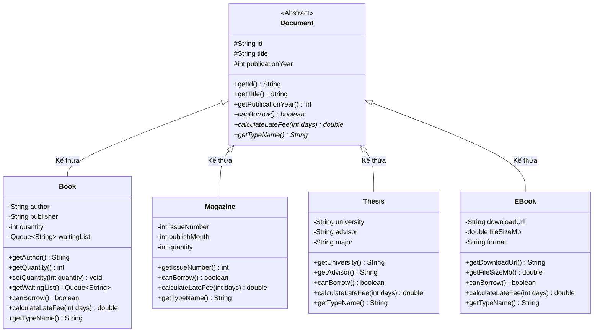
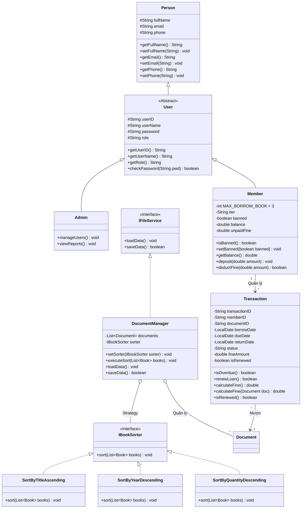

# BÁO CÁO ĐỒ ÁN MÔN HỌC LẬP TRÌNH HƯỚNG ĐỐI TƯỢNG (OOP)
## Đề tài: Hệ thống Quản lý Thư viện (Library Management System – Desktop GUI)

---

# MILESTONE 3 – UML DESIGN (Thiết kế UML)
*(Tương ứng giai đoạn: Class Diagram, Relationships, Inheritance – Sau chương 6)*

## 3.1. Thiết kế Kế thừa & Đa hình (Inheritance & Polymorphism)

### 1. Cây phân cấp Người dùng (`Person` $\leftarrow$ `User` $\leftarrow$ `Admin`, `Member`)
* `Person` đóng gói các thuộc tính nhân thân cơ bản (`fullName`, `email`, `phone`).
* `User` là lớp trừu tượng (`abstract`) mở rộng `Person`, bổ sung thông tin xác thực (`userID`, `userName`, `password`, `role`).
* `Admin` và `Member` kế thừa `User`, tái sử dụng toàn bộ cơ chế kiểm tra mật khẩu (`checkPassword`) và mở rộng hành vi riêng cho từng vai trò (`manageUsers()`, `viewReports()` ở `Admin`; `deposit()`, `deductFine()`, quản lý ví và khóa tài khoản ở `Member`).

### 2. Cây phân cấp Tài liệu (`Document` $\leftarrow$ `Book`, `Magazine`, `Thesis`, `EBook`)
* `Document` là lớp trừu tượng (`abstract`) định nghĩa khung chung (`id`, `title`, `publicationYear`) và 3 phương thức trừu tượng để các lớp con thể hiện **Đa hình**:

| Lớp con | `canBorrow()` | `calculateLateFee(int days)` | `getTypeName()` |
| :--- | :--- | :--- | :--- |
| **`Book`** | `quantity > 0` | `days * 5.000 VNĐ` (nếu `days > 0`) | `"Sách"` |
| **`Magazine`** | `quantity > 0` | `days * 5.000 VNĐ` (nếu `days > 0`) | `"Tạp chí"` |
| **`Thesis`** | Luôn trả về `false` *(chỉ đọc tại chỗ)* | `0.0 VNĐ` | `"Luận văn"` |
| **`EBook`** | Luôn trả về `true` *(tài nguyên số không giới hạn)* | `0.0 VNĐ` *(hết hạn tự ngắt quyền truy cập)* | `"E-Book"` |

## 3.2. Thiết kế Các Mối quan hệ UML (Relationships)
* **Kế thừa (Generalization / Inheritance `---|>`):** `User` kế thừa `Person`; `Admin`, `Member` kế thừa `User`; `Book`, `Magazine`, `Thesis`, `EBook` kế thừa `Document`.
* **Hiện thực hóa giao diện (Realization `..|>`):**
  * `SortByTitleAscending`, `SortByYearDescending`, `SortByQuantityDescending` cài đặt `IBookSorter`.
  * `DocumentManager`, `UserManager`, `TransactionManager` cài đặt `IFileService`.
* **Kết tập (Aggregation `o--`) & Kết hợp (Association `-->`):**
  * `DocumentManager` `o--` `IBookSorter` (Strategy Composition: có thể thay đổi chiến lược sắp xếp động tại runtime qua `setSorter(...)`).
  * `DocumentManager` `o--` `*` `Document`; `UserManager` `o--` `*` `User`; `TransactionManager` `o--` `*` `Transaction`.
  * `Member` `1` $\rightarrow$ `*` `Transaction` (một độc giả sở hữu nhiều phiếu mượn).
  * `Transaction` `*` $\rightarrow$ `1` `Document` (mỗi phiếu mượn gắn với một tài liệu).
* **Phụ thuộc (Dependency `..>`):** Các lớp `Controller` và `View` sử dụng tầng `Manager` và các lớp `Util` (`Validator`, `DateUtil`, `FormatUtil`, `TextUtil`, `FileUtil`).

## 3.3. Sơ đồ Lớp (Class Diagrams)

### A. Sơ đồ Lớp Phân cấp Tài liệu (Mục 5.2 SRS)

### B. Sơ đồ Lớp Người dùng, Giao dịch & Strategy Pattern (Mục 5.3 & 5.5 SRS)

