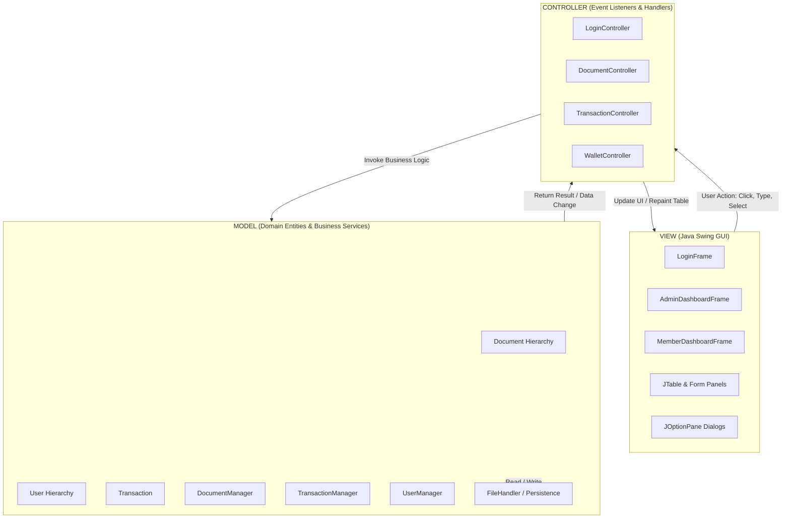
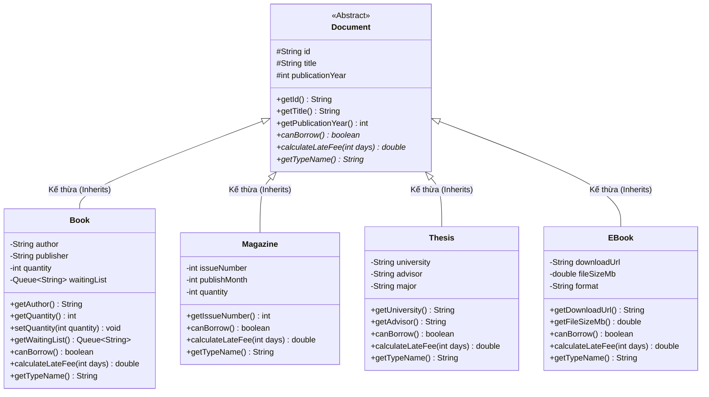
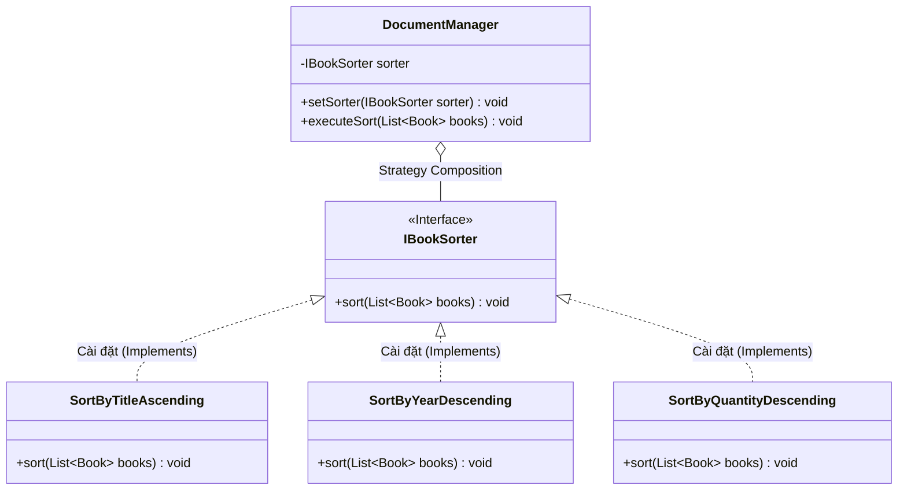
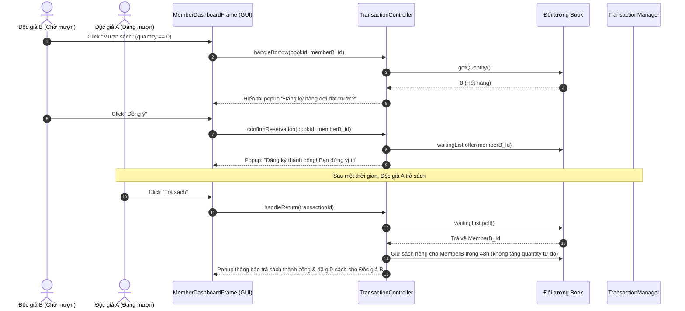
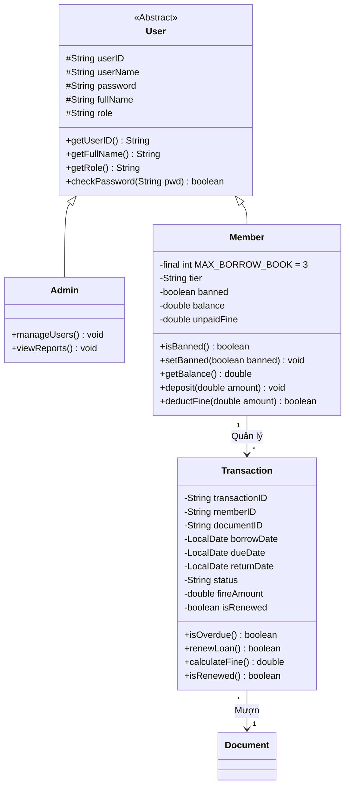

# TÀI LIỆU ĐẶC TẢ YÊU CẦU PHẦN MỀM (SRS)

- **Dự án:** Hệ thống Quản lý Thư viện (Library Management System - Desktop GUI Version)
- **Môn học:** Lập trình Hướng đối tượng (OOP)
- **Công nghệ Giao diện:** Java Swing & AWT (Mô hình MVC)

---

<!-- @import "[TOC]" -->

## 1. Giới thiệu

Tài liệu này đặc tả toàn diện các yêu cầu chức năng, Use Case chi tiết và định hướng thiết kế Kiến trúc Hướng đối tượng (OOP) cho **Hệ thống Quản lý Thư viện (Library Management System)** phiên bản **Giao diện Đồ họa (Desktop GUI)**.

Hệ thống được xây dựng nhằm phục vụ đồ án môn học **Lập trình Hướng đối tượng (OOP)**, sử dụng ứng dụng cửa sổ tương tác trực quan phát triển bằng **Java Swing**. Hệ thống trình diễn trọn vẹn và chuẩn mực 4 nguyên lý OOP cốt lõi:
1. **Đóng gói (Encapsulation):** Bảo vệ tính toàn vẹn trạng thái đối tượng, xử lý ràng buộc và che giấu dữ liệu qua các getter/setter và phương thức nghiệp vụ.
2. **Kế thừa (Inheritance):** Thiết lập cấu trúc phân cấp tài liệu (`Document` -> `Book`, `Magazine`, `Thesis`, `EBook`) và người dùng (`User` -> `Admin`, `Member`).
3. **Đa hình (Polymorphism):** Ghi đè phương thức nghiệp vụ (`canBorrow()`, `calculateLateFee()`, `displayInfo()`) và ứng dụng các giao diện chuẩn (`IBookSorter`, `Comparable`, `Comparator`).
4. **Trừu tượng (Abstraction):** Trừu tượng hóa các khái niệm thực thể nghiệp vụ thông qua Abstract Class và Interface.

Hệ thống vận hành theo kiến trúc chuẩn **Model - View - Controller (MVC)**, tách bạch hoàn toàn giữa Logic Nghiệp vụ, Giao diện Người dùng và Xử lý Sự kiện. Dữ liệu được quản lý bền vững thông qua hệ thống File I/O (Text/CSV).

---

## 2. Các Tác nhân (Actors)

Hệ thống hỗ trợ 3 nhóm tác nhân tương tác thông qua các màn hình giao diện đồ họa chuyên biệt:

* **Admin (Quản trị viên / Thủ thư):** Sử dụng cửa sổ Quản trị (`AdminDashboardFrame`). Có toàn quyền quản lý kho tài liệu (Thêm, Sửa, Xóa thông qua Form và Bảng dữ liệu), quản lý người dùng, xử lý tiếp nhận trả sách, áp dụng phí phạt, và theo dõi các chỉ số thống kê phân tích trực quan qua biểu đồ/bảng số liệu.
* **Member (Độc giả):** Đăng nhập vào cửa sổ Độc giả (`MemberDashboardFrame`). Tra cứu và tìm kiếm tài liệu với tính năng lọc trực tiếp (Live Search), sắp xếp danh mục đa tiêu chí, thao tác mượn/trả và gia hạn chỉ với một cú nhấp chuột, tham gia hàng đợi đặt trước khi sách hết, và quản lý số dư ví cá nhân để thanh toán phạt.
* **Guest (Khách vãng lai):** Sử dụng giao diện tra cứu mở tại màn hình Đăng nhập (`LoginFrame`). Được xem danh mục tài liệu công khai, tìm kiếm sách cơ bản và mở Form Đăng ký tài khoản độc giả mới thông qua hộp thoại đồ họa (`RegisterDialog`).

---

## 3. Yêu cầu Chức năng (Functional Requirements)

| Mã YC | Tên Chức năng | Mô tả chi tiết trên Giao diện Đồ họa (GUI Swing) |
| :--- | :--- | :--- |
| **FR-01** | Giao diện Đồ họa Người dùng (GUI) | Xây dựng ứng dụng hoàn toàn bằng Java Swing (`JFrame`, `JPanel`, `JTabbedPane`). Bố cục trực quan bằng Layout Managers (`BorderLayout`, `CardLayout`, `GridBagLayout`). Dữ liệu hiển thị dạng bảng cuộn (`JTable` trong `JScrollPane`). Báo cáo trạng thái và xác nhận hành động qua popup (`JOptionPane`). |
| **FR-02** | Đăng nhập & Điều hướng Giao diện | Màn hình đăng nhập đồ họa gồm trường nhập `JTextField`, trường mật khẩu `JPasswordField` và nút Đăng nhập (`JButton`). Hệ thống tự động xác thực và đóng màn hình đăng nhập, mở ra Dashboard tương ứng (`AdminDashboardFrame` hoặc `MemberDashboardFrame`). |
| **FR-03** | Quản lý Tài liệu qua Form & Bảng | Thủ thư thêm, cập nhật thông tin tài liệu thông qua Form nhập liệu trực quan với kiểm tra hợp lệ dữ liệu nhập (Validation). Chọn dòng trên `JTable` để hiển thị chi tiết lên Form hoặc nhấn nút "Sửa", "Xóa". Bảng dữ liệu tự động làm mới ngay sau khi thao tác. |
| **FR-04** | Tìm kiếm Tức thì (Live Search) | Ô tìm kiếm (`JTextField`) lắng nghe sự kiện gõ phím (`DocumentListener`). Danh sách tài liệu trên `JTable` tự động lọc theo thời gian thực ngay khi người dùng nhập từng ký tự, kết hợp cùng ComboBox (`JComboBox`) chọn tiêu chí tìm kiếm (Theo Tên, Tác giả, Mã ID). |
| **FR-05** | Mượn Tài liệu Một Chạm | Độc giả chọn tài liệu mong muốn trực tiếp trên bảng và nhấn nút "Mượn tài liệu". Hệ thống kiểm tra điều kiện (tồn kho, hạn mức mượn, trạng thái khóa tài khoản) và mở hộp thoại xác nhận ngày trả dự kiến. Số lượng trên bảng tự động trừ đi 1. |
| **FR-06** | Trả Tài liệu & Xử lý Phạt | Thủ thư hoặc độc giả chọn giao dịch mượn trên bảng giao dịch và nhấn "Trả tài liệu". Hệ thống tự động tính số ngày quá hạn, hiển thị popup tiền phạt (5.000 VNĐ/ngày). Cung cấp tùy chọn trừ trực tiếp từ ví độc giả (`Fine Wallet`). |
| **FR-07** | Đồng bộ Dữ liệu Ngầm (File I/O) | Tự động tải dữ liệu từ File vào các cấu trúc Collection trong Memory khi ứng dụng khởi chạy. Mọi thao tác thay đổi dữ liệu trên GUI đều kích hoạt Controller đồng bộ ngầm xuống File (Text/CSV), bảo đảm an toàn dữ liệu mà không làm gián đoạn trải nghiệm người dùng. |
| **FR-08** | Đăng ký Tài khoản qua Form Dialog | Khách nhấn nút "Đăng ký" trên màn hình Đăng nhập để mở cửa sổ con (`RegisterDialog`). Nhập thông tin họ tên, tên đăng nhập, mật khẩu; hệ thống kiểm tra tính duy nhất và định dạng dữ liệu, thông báo thành công qua `JOptionPane`. |
| **FR-09** | Quản lý & Lọc Lịch sử Giao dịch | Hiển thị toàn bộ lịch sử mượn/trả trên bảng `JTable`. Hỗ trợ ComboBox bộ lọc trạng thái nhanh: "Tất cả", "Đang mượn", "Đã trả", "Quá hạn". Đánh dấu màu nổi bật (Cell Renderer) cho các giao dịch bị trễ hạn. |
| **FR-10** | **Gia hạn Mượn Tài liệu (Renew Loan)** | Trên bảng giao dịch cá nhân của độc giả, nhấn nút "Gia hạn" trên dòng giao dịch đang mượn. Hệ thống kiểm tra điều kiện (chưa từng gia hạn, chưa quá hạn, không có ai trong hàng đợi đặt trước) và hiển thị thông báo cộng thêm 07 ngày vào hạn trả. |
| **FR-11** | **Sắp xếp Nâng cao (Strategy Pattern)** | Cung cấp ComboBox chọn chiến lược sắp xếp ngay trên thanh công cụ của bảng tài liệu: "Tên sách A-Z", "Năm xuất bản mới nhất", "Số lượng tồn kho nhiều nhất". Áp dụng **Strategy Pattern** (`IBookSorter`) để sắp xếp và làm mới bảng ngay lập tức. |
| **FR-12** | **Hàng đợi Đặt trước (Reservation Queue)** | Khi độc giả nhấn "Mượn" một cuốn sách đã hết hàng (`quantity == 0`), hệ thống hiển thị popup: "Sách tạm hết. Bạn có muốn tham gia hàng đợi đặt trước không?". Khi người dùng đồng ý, `memberId` được đưa vào `Queue` (FIFO). Khi sách được trả, hệ thống gửi thông báo giữ sách ưu tiên cho người đầu hàng đợi. |
| **FR-13** | **Báo cáo & Thống kê Trực quan (Admin Dashboard)** | Màn hình riêng dành cho Thủ thư hiển thị các thẻ tổng quan (KPI Cards: Tổng số sách, Sách đang mượn, Sách quá hạn, Doanh thu phạt) kết hợp bảng dữ liệu "Top 3 sách mượn nhiều nhất" và "Danh sách độc giả nợ sách quá hạn" sử dụng **Java Stream API**. |
| **FR-14** | **Đa dạng hóa Danh mục Tài liệu (Đa hình)** | Hệ thống quản lý nhiều dạng tài liệu kế thừa từ lớp trừu tượng `Document`: `Book` (sách), `Magazine` (tạp chí), `Thesis` (luận văn - chỉ đọc tại chỗ), `EBook` (sách điện tử - mở liên kết đọc trực tuyến). Form nhập liệu trên giao diện tự động thay đổi các trường dữ liệu tùy theo loại tài liệu được chọn. |
| **FR-15** | **Ví tiền Độc giả & Thanh toán Phạt (Fine Wallet)** | Thanh trạng thái cá nhân hiển thị số dư ví (`balance`) và nợ phạt tích lũy. Nút "Nạp tiền" mở popup nạp tiền nhanh. Nếu nợ quá 50.000 VNĐ, tài khoản tự động bị khóa (`banned = true`), hiển thị badge cảnh báo đỏ và vô hiệu hóa nút "Mượn tài liệu". |

---

## 4. Use Case Chi Tiết (GUI Interaction)

### UC-01: Đăng nhập & Chuyển đổi Giao diện
| Mục | Nội dung chi tiết |
| :--- | :--- |
| **Tác nhân (Actor)** | Admin, Member, Guest |
| **Tiền điều kiện** | Ứng dụng đã khởi chạy, cửa sổ `LoginFrame` hiển thị trên màn hình. |
| **Luồng sự kiện chính** | 1. Người dùng nhập Username và Password vào các ô `JTextField` và `JPasswordField`. 2. Nhấn nút "Đăng nhập" (hoặc nhấn phím Enter). 3. Controller tiếp nhận sự kiện, kiểm tra thông tin với `UserManager`. 4. Nếu thông tin chính xác: &emsp;- Đóng cửa sổ `LoginFrame`. &emsp;- Khởi tạo và hiển thị cửa sổ làm việc tương ứng: `AdminDashboardFrame` (nếu là Admin) hoặc `MemberDashboardFrame` (nếu là Member). &emsp;- Hiển thị thông điệp chào mừng trên thanh trạng thái. |
| **Luồng ngoại lệ** | - Nhập sai thông tin hoặc bỏ trống: Hiển thị popup `JOptionPane.showErrorMessage` thông báo "Tên đăng nhập hoặc mật khẩu không chính xác!", con trỏ tự động focus lại ô nhập. - Khách vãng lai (Guest): Có thể nhấn nút "Xem danh mục khách" để mở bảng xem sách công khai mà không cần đăng nhập. |
| **Hậu điều kiện** | Phiên đăng nhập được thiết lập; cửa sổ làm việc chính hiển thị với đầy đủ quyền hạn của tác nhân. |

---

### UC-02: Quản lý Danh mục Tài liệu (Thêm, Sửa, Xóa)
| Mục | Nội dung chi tiết |
| :--- | :--- |
| **Tác nhân (Actor)** | Admin |
| **Tiền điều kiện** | Admin đang mở tab "Quản lý Tài liệu" trên `AdminDashboardFrame`. |
| **Luồng sự kiện chính** | **1. Thêm tài liệu mới:** &emsp;- Chọn loại tài liệu từ ComboBox (Sách, Tạp chí, Luận văn, E-Book). Form nhập liệu tự động hiển thị các trường tương ứng. &emsp;- Nhập thông tin chi tiết và nhấn nút "Thêm mới". &emsp;- Hệ thống kiểm tra hợp lệ, thêm vào kho dữ liệu, đồng bộ xuống File và tự động chèn dòng mới vào `JTable`. **2. Cập nhật tài liệu:** &emsp;- Nhấp chuột vào một dòng trên `JTable`, dữ liệu tự động điền lên Form. &emsp;- Admin chỉnh sửa thông tin và nhấn "Cập nhật". Hệ thống lưu dữ liệu và làm mới bảng. **3. Xóa tài liệu:** &emsp;- Chọn dòng trên bảng và nhấn nút "Xóa". &emsp;- Xuất hiện hộp thoại xác nhận `JOptionPane.showConfirmDialog`. Nếu Admin chọn "Yes", tài liệu được gỡ khỏi hệ thống và bảng cập nhật ngay lập tức. |
| **Luồng ngoại lệ** | - Bỏ trống trường bắt buộc hoặc nhập chữ vào trường số: Hiển thị cảnh báo lỗi cụ thể cạnh ô nhập hoặc qua popup. - Trùng mã ID tài liệu khi thêm mới: Hiển thị thông báo "Mã tài liệu đã tồn tại trong hệ thống!". |
| **Hậu điều kiện** | Danh mục tài liệu trong bộ nhớ và File được cập nhật; bảng `JTable` hiển thị trạng thái mới nhất. |

---

### UC-03: Tra cứu & Tìm kiếm tức thì (Live Search)
| Mục | Nội dung chi tiết |
| :--- | :--- |
| **Tác nhân (Actor)** | Guest, Member, Admin |
| **Tiền điều kiện** | Màn hình hiển thị danh sách tài liệu (`JTable`) đang mở. |
| **Luồng sự kiện chính** | 1. Người dùng chọn tiêu chí tìm kiếm từ ComboBox (Tất cả, Tiêu đề, Tác giả, Mã ID). 2. Người dùng gõ từ khóa vào ô tìm kiếm (`searchField`). 3. Sự kiện `DocumentListener` kích hoạt sau mỗi ký tự gõ vào. 4. Controller sử dụng `RowFilter` trên `TableRowSorter` (hoặc Stream lọc danh sách) để lọc bảng ngay lập tức trong thời gian thực. 5. Bảng `JTable` chỉ hiển thị các tài liệu khớp với chuỗi tìm kiếm. |
| **Luồng ngoại lệ** | Không có tài liệu nào khớp: Bảng dữ liệu hiển thị trạng thái trống và thanh trạng thái ghi chú "Tìm thấy 0 kết quả phù hợp". Khi xóa trắng ô tìm kiếm, bảng lập tức hoàn nguyên toàn bộ danh sách. |
| **Hậu điều kiện** | Người dùng quan sát thấy danh sách tài liệu thu hẹp theo đúng nhu cầu tìm kiếm mà không cần phải nhấn phím Enter hay nút Tìm kiếm. |

---

### UC-04: Mượn Tài liệu Một Chạm
| Mục | Nội dung chi tiết |
| :--- | :--- |
| **Tác nhân (Actor)** | Member |
| **Tiền điều kiện** | Độc giả đã đăng nhập; tài khoản không bị khóa (`banned == false`); số lượng sách đang mượn chưa chạm mức tối đa (3 cuốn). |
| **Luồng sự kiện chính** | 1. Độc giả nhấp chuột chọn một cuốn sách trên bảng danh mục tài liệu. 2. Nhấn nút "Mượn tài liệu". 3. Hệ thống kiểm tra nghiệp vụ tự động: &emsp;a. Kiểm tra đa hình: Gọi phương thức `canBorrow()`. Nếu là Luận văn (`Thesis`), hiển thị popup: "Luận văn chỉ được phép đọc tại chỗ, không cho mượn về!". &emsp;b. Kiểm tra tồn kho: `quantity > 0`. 4. Nếu hợp lệ, hệ thống tạo đối tượng `Transaction`, thiết lập hạn trả `dueDate` sau 14 ngày, trừ 1 số lượng tồn kho. 5. Hiển thị popup thông báo thành công: "Mượn sách thành công! Hạn trả của bạn là: [dd/MM/yyyy]". 6. Bảng `JTable` tài liệu tự động giảm số lượng hiển thị, và bảng "Sách đang mượn" của độc giả xuất hiện thêm dòng mới. |
| **Luồng ngoại lệ** | - Sách hết hàng (`quantity == 0`): Hệ thống mở hộp thoại `JOptionPane.showConfirmDialog`: "Cuốn sách này hiện đã hết bản sao. Bạn có muốn tham gia hàng đợi đặt trước không?". Nếu chọn "Có", hệ thống chuyển tiếp sang UC-07. - Tài khoản bị khóa (do nợ phạt quá 50.000 VNĐ): Hiển thị popup cảnh báo đỏ: "Tài khoản của bạn đang bị khóa do nợ phạt quá hạn! Vui lòng nạp tiền vào ví để mở khóa trước khi mượn sách". |
| **Hậu điều kiện** | Bản ghi giao dịch được tạo và lưu trữ; số lượng tồn kho cập nhật đồng bộ trên giao diện và tập tin. |

---

### UC-05: Trả Tài liệu & Xử lý Phạt Trực quan
| Mục | Nội dung chi tiết |
| :--- | :--- |
| **Tác nhân (Actor)** | Admin, Member |
| **Tiền điều kiện** | Tồn tại giao dịch mượn đang trong trạng thái `BORROWED`. |
| **Luồng sự kiện chính** | 1. Người dùng chọn giao dịch trên bảng "Danh sách đang mượn" và nhấn nút "Trả tài liệu". 2. Hệ thống kiểm tra ngày trả thực tế (`LocalDate.now()`) so với `dueDate`: &emsp;- Nếu trả đúng hạn: Hiển thị popup thông báo "Trả sách đúng hạn thành công!". &emsp;- Nếu trả quá hạn: Tính số ngày trễ $\times$ 5.000 VNĐ. Hiển thị popup xác nhận thanh toán tiền phạt: "Bạn trả trễ [X] ngày. Tiền phạt: [Y] VNĐ. Trừ tiền trực tiếp từ ví độc giả?". 3. Nếu ví đủ tiền, hệ thống trừ số dư ví và hoàn tất. Nếu ví không đủ, ghi nhận khoản nợ tích lũy. 4. Kiểm tra **Hàng đợi đặt trước (Reservation Queue)** của cuốn sách: &emsp;- Nếu có người chờ: Sách được gán trạng thái "Giữ riêng cho độc giả [MemberID] trong 48h", không tăng vào kho công cộng. &emsp;- Nếu không có ai chờ: Tăng số lượng tồn kho `quantity = quantity + 1`. 5. Bảng giao dịch cập nhật trạng thái `RETURNED`, bảng tài liệu làm mới số lượng. |
| **Luồng ngoại lệ** | Tổng số nợ phạt sau khi trả sách vượt quá 50.000 VNĐ: Hệ thống chuyển trạng thái tài khoản thành `banned = true`, hiển thị popup cảnh báo và đổi màu badge trạng thái độc giả sang màu đỏ. |
| **Hậu điều kiện** | Giao dịch hoàn tất; số dư ví và trạng thái sách được cập nhật trực quan trên GUI. |

---

### UC-06: Gia hạn Mượn Tài liệu (Renew Loan)
| Mục | Nội dung chi tiết |
| :--- | :--- |
| **Tác nhân (Actor)** | Member |
| **Tiền điều kiện** | Độc giả chọn một giao dịch đang mượn trên bảng cá nhân. |
| **Luồng sự kiện chính** | 1. Độc giả chọn giao dịch muốn gia hạn và nhấn nút "Gia hạn mượn" trên thanh công cụ. 2. Hệ thống kiểm tra các điều kiện nghiệp vụ: &emsp;a. Đã gia hạn lần nào chưa: `isRenewed == false`. &emsp;b. Đã quá hạn trả chưa: `LocalDate.now().isAfter(dueDate) == false`. &emsp;c. Có ai đang đợi sách trong hàng đợi không: `waitingList.isEmpty() == true`. 3. Nếu tất cả điều kiện thỏa mãn: Cộng thêm 7 ngày vào `dueDate`, đánh dấu `isRenewed = true`. 4. Hiển thị popup thông báo: "Gia hạn thành công! Hạn trả mới của bạn là: [dd/MM/yyyy]". 5. Cột "Hạn trả" và cột "Đã gia hạn" trên bảng `JTable` được cập nhật ngay lập tức. |
| **Luồng ngoại lệ** | - Đã gia hạn 1 lần trước đó: Popup cảnh báo "Mỗi phiếu mượn chỉ được phép gia hạn tối đa 01 lần!". - Đã quá hạn trả: Popup cảnh báo "Tài liệu đã quá hạn, không thể gia hạn. Vui lòng mang sách trả và đóng phạt!". - Có người đang xếp hàng chờ: Popup thông báo "Cuốn sách đang có độc giả khác đặt trước, không thể gia hạn thêm!". |
| **Hậu điều kiện** | `dueDate` được tăng thêm 7 ngày; thuộc tính `isRenewed` đổi thành `true`; dữ liệu đồng bộ xuống File. |

---

### UC-07: Đặt trước Tài liệu (Reservation Queue)
| Mục | Nội dung chi tiết |
| :--- | :--- |
| **Tác nhân (Actor)** | Member |
| **Tiền điều kiện** | Tài liệu hết tồn kho (`quantity == 0`); độc giả chưa tham gia hàng đợi của tài liệu này. |
| **Luồng sự kiện chính** | 1. Khi độc giả nhấn "Mượn" một cuốn sách đã hết hàng, hệ thống bật popup hỏi: "Tài liệu này hiện đã hết. Bạn có muốn đặt trước để giữ chỗ khi có sách trả không?". 2. Độc giả nhấn "Đồng ý". 3. Hệ thống đưa mã `memberId` vào cuối `Queue<String> waitingList` của đối tượng sách. 4. Hiển thị popup thông báo: "Bạn đã tham gia hàng đợi thành công! Vị trí của bạn trong danh sách chờ: #[Số thứ tự]". 5. Cột thông tin "Số người chờ" trên bảng tài liệu cập nhật tăng thêm 1. |
| **Luồng ngoại lệ** | Độc giả đã nằm trong danh sách chờ của cuốn sách này: Báo lỗi qua popup "Bạn đã đăng ký đặt trước tài liệu này trước đó rồi!". |
| **Hậu điều kiện** | `memberId` được thêm vào cấu trúc `Queue` của sách; đảm bảo nguyên tắc ưu tiên FIFO. |

---

### UC-08: Xem Dashboard Báo cáo & Thống kê
| Mục | Nội dung chi tiết |
| :--- | :--- |
| **Tác nhân (Actor)** | Admin |
| **Tiền điều kiện** | Admin đăng nhập và mở tab "Báo cáo & Thống kê" trên `AdminDashboardFrame`. |
| **Luồng sự kiện chính** | 1. Khi tab được chọn, Controller tự động kích hoạt các truy vấn phân tích sử dụng **Java Stream API**: &emsp;- Tính toán 4 thẻ chỉ số nhanh (KPI Panels): Tổng đầu sách, Tổng số sách đang được mượn, Số lượt mượn bị quá hạn, Tổng tiền phạt đã thu. &emsp;- Lọc và sắp xếp "Top 3 cuốn sách được mượn nhiều nhất" hiển thị trên một `JTable` chuyên biệt. &emsp;- Lọc "Danh sách độc giả đang nợ sách quá hạn" hiển thị trên bảng cảnh báo có thanh cuộn. 2. Cung cấp nút "Làm mới (Refresh)" để cập nhật số liệu thống kê mới nhất. 3. Cung cấp nút "Xuất báo cáo" (tùy chọn) để lưu thông tin thống kê ra file văn bản. |
| **Luồng ngoại lệ** | Chưa có giao dịch nào trong hệ thống: Các thẻ hiển thị số 0 và bảng thông báo "Chưa có dữ liệu thống kê". |
| **Hậu điều kiện** | Toàn bộ số liệu hoạt động của thư viện được trực quan hóa rõ ràng trên màn hình quản trị. |

---

### UC-09: Quản lý Ví tiền & Nạp tiền (Fine Wallet)
| Mục | Nội dung chi tiết |
| :--- | :--- |
| **Tác nhân (Actor)** | Member |
| **Tiền điều kiện** | Độc giả đang đăng nhập trên `MemberDashboardFrame`. |
| **Luồng sự kiện chính** | 1. Trên thanh thông tin tài khoản, độc giả quan sát thấy Số dư ví (`balance`) và Số nợ quá hạn. 2. Độc giả nhấn nút "Nạp tiền vào ví". 3. Xuất hiện hộp thoại nhập liệu `JOptionPane.showInputDialog` yêu cầu nhập số tiền muốn nạp (VNĐ). 4. Độc giả nhập số tiền (ví dụ: 100000) và nhấn "Xác nhận". 5. Hệ thống kiểm tra số tiền > 0, cộng dồn vào `balance`. 6. Nếu tài khoản trước đó bị khóa (`banned == true`) và số dư mới đã đủ thanh toán hết khoản nợ tích lũy: Hệ thống tự động trừ nợ, mở khóa tài khoản (`banned = false`), đổi màu badge trạng thái sang "Hoạt động". 7. Cập nhật nhãn số dư ví trên giao diện và lưu dữ liệu xuống File. |
| **Luồng ngoại lệ** | Nhập ký tự không phải số hoặc nhập số âm: Hiển thị popup lỗi "Số tiền nạp không hợp lệ! Vui lòng nhập số nguyên dương". |
| **Hậu điều kiện** | Số dư ví `balance` của Member tăng lên; trạng thái cấm mượn được giải tỏa nếu đã hết nợ. |

---

## 5. Thiết kế Kiến trúc Hướng đối tượng & Mẫu Thiết kế (OOP Architecture)

### 5.1. Kiến trúc Hệ thống theo Mô hình MVC (Model - View - Controller)

Toàn bộ ứng dụng được tổ chức chuẩn hóa theo mô hình MVC, tách biệt độc lập giữa Giao diện người dùng và Xử lý nghiệp vụ:

---

### 5.2. Sơ đồ Cây Phân cấp Kế thừa & Đa hình (Document Hierarchy)

Mọi ấn phẩm thư viện đều kế thừa từ lớp trừu tượng `Document`, giúp tận dụng tối đa Đa hình trong việc xử lý mượn, trả và tính phí phạt:

#### Hành vi Đa hình cốt lõi:
- **`canBorrow()`**:
  - `Book`: Cho phép mượn về nhà nếu số lượng tồn kho `quantity > 0`.
  - `Magazine`: Cho phép mượn ngắn hạn nếu `quantity > 0`.
  - `Thesis` (Luận văn): Luôn trả về `false` (Quy định: Chỉ được nghiên cứu tại chỗ trong thư viện).
  - `EBook` (Sách điện tử): Luôn trả về `true` (Không giới hạn số lượng bản sao vật lý).
- **`calculateLateFee(int days)`**:
  - `Book`, `Magazine`: $days \times 5.000$ VNĐ.
  - `EBook`: Luôn bằng $0$ VNĐ (Tài nguyên số, hết hạn tự khóa quyền truy cập).

---

### 5.3. Ứng dụng Strategy Pattern cho Sắp xếp Danh mục trên GUI

Trên giao diện, khi người dùng lựa chọn một tiêu chí trong ComboBox sắp xếp, Controller gán Strategy tương ứng cho Manager và tiến hành sắp xếp dữ liệu bảng mà không cần dùng cấu trúc `switch-case` phân nhánh phức tạp:

---

### 5.4. Sơ đồ Tuần tự: Tương tác Đặt trước và Hoàn trả (Reservation Sequence Diagram)

---

### 5.5. Sơ đồ Lớp Miền Thực thể & Người dùng (Domain & User Model)

---

## 6. Thiết kế Chi tiết Giao diện Đồ họa (GUI Components & Layout)

Hệ thống được tổ chức thành các màn hình và thành phần giao diện Java Swing chuyên biệt:

### 6.1. Màn hình Đăng nhập (`LoginFrame`)
* **Kích thước chuẩn:** $450 \times 400$ px, căn giữa màn hình (`setLocationRelativeTo(null)`).
* **Thành phần:**
  - Tiêu đề ứng dụng ("HỆ THỐNG QUẢN LÝ THƯ VIỆN - OOP LMS").
  - Ô nhập `txtUsername`, ô nhập mật khẩu `txtPassword` có icon trực quan.
  - Nút bấm `btnLogin` (Đăng nhập) và `btnRegister` (Đăng ký tài khoản mới).
  - Nút `btnGuest` ("Duyệt danh mục tài liệu với quyền Khách").

### 6.2. Cửa sổ Quản trị viên (`AdminDashboardFrame`)
* **Kích thước chuẩn:** $1100 \times 700$ px.
* **Bố cục chính (`JTabbedPane`):**
  1. **Tab 1 - Quản lý Kho Tài liệu:**
     - Nửa trên: Form nhập thông tin chi tiết (Mã, Tên, Thể loại, Tác giả/Kỳ XB, Năm, Số lượng) với các nút "Thêm mới", "Cập nhật", "Xóa", "Làm mới Form".
     - Nửa dưới: Thanh tìm kiếm trực tiếp (Live Search) và bảng `JTable` hiển thị toàn bộ tài liệu có thanh cuộn `JScrollPane`.
  2. **Tab 2 - Quản lý Giao dịch & Trả sách:**
     - Bảng hiển thị toàn bộ giao dịch với ComboBox lọc theo trạng thái: "Đang mượn", "Đã trả", "Quá hạn".
     - Nút "Xác nhận trả sách" và nút "Thu phí phạt".
  3. **Tab 3 - Báo cáo & Thống kê (Dashboard):**
     - Hàng trên: 4 thẻ Panel thống kê (Thẻ tổng sách, Thẻ sách đang mượn, Thẻ sách quá hạn, Thẻ doanh thu phạt).
     - Hàng dưới: Bảng "Top 3 sách mượn nhiều nhất" và bảng "Độc giả nợ sách quá hạn".

### 6.3. Cửa sổ Độc giả (`MemberDashboardFrame`)
* **Kích thước chuẩn:** $1000 \times 650$ px.
* **Bố cục chính:**
  - **Header Panel:** Hiển thị thông tin cá nhân (Họ tên, Mã độc giả, Hạng thành viên, Số dư ví, Trạng thái tài khoản Badge Xanh/Đỏ) và nút "Nạp tiền ví".
  - **Tab 1 - Tra cứu & Mượn tài liệu:**
    - Thanh công cụ phía trên gồm: Ô tìm kiếm tức thì (Live Search), ComboBox sắp xếp đa tiêu chí (Strategy Pattern), và nút "Mượn tài liệu".
    - Bảng danh mục tài liệu hiển thị số lượng tồn kho và số người đang đặt trước trong hàng đợi.
  - **Tab 2 - Sách đang mượn & Lịch sử cá nhân:**
    - Bảng danh sách các tài liệu độc giả đang mượn kèm ngày hết hạn.
    - Nút "Gia hạn mượn (+7 ngày)" và nút "Trả sách".

---

## 7. Yêu cầu Phi Chức năng (Non-Functional Requirements)

1. **Trải nghiệm Người dùng & Thẩm mỹ (UI/UX):**
   - Ứng dụng áp dụng Look and Feel hiện đại (FlatLaf hoặc Nimbus Look & Feel) giúp các nút bấm, bảng dữ liệu và thanh cuộn đẹp mắt, rõ ràng.
   - Xử lý phím tắt tiện lợi (nhấn Enter để đăng nhập, phím Esc để đóng hộp thoại).
2. **Hiệu năng & Khả năng Phản hồi (Responsiveness):**
   - Thao tác tìm kiếm trực tiếp (Live Search) và sắp xếp trên `JTable` đáp ứng tức thời (< 50ms) trên tập dữ liệu hàng nghìn bản ghi.
   - Các thao tác đọc/ghi file bền vững được xử lý an toàn, không gây hiện tượng đóng băng cửa sổ (freeze UI).
3. **Toàn vẹn Dữ liệu (Data Persistence & Safety):**
   - Cơ chế lưu trữ dạng tập tin (Text/CSV) tự động sao lưu dữ liệu ngay sau mỗi giao dịch mượn, trả, thêm, sửa, xóa thành công.
4. **Kiểm soát & Bẫy lỗi Toàn diện (Robust Exception Handling):**
   - Mọi ngoại lệ nhập liệu từ người dùng (nhập chữ vào ô số, để trống trường bắt buộc, nhập ngày sai định dạng) đều được bắt chính xác và hiển thị hộp thoại cảnh báo thân thiện (`JOptionPane.showMessageDialog`), ngăn chặn hoàn toàn tình trạng sập chương trình.
5. **Khả năng Mở rộng (Extensibility):**
   - Thiết kế tuân thủ nguyên lý Đóng/Mở (Open/Closed Principle): Dễ dàng bổ sung loại ấn phẩm mới (như Báo ngày, Đĩa CD) hoặc thêm giao diện mới mà không cần sửa đổi mã nguồn xử lý logic cốt lõi.
