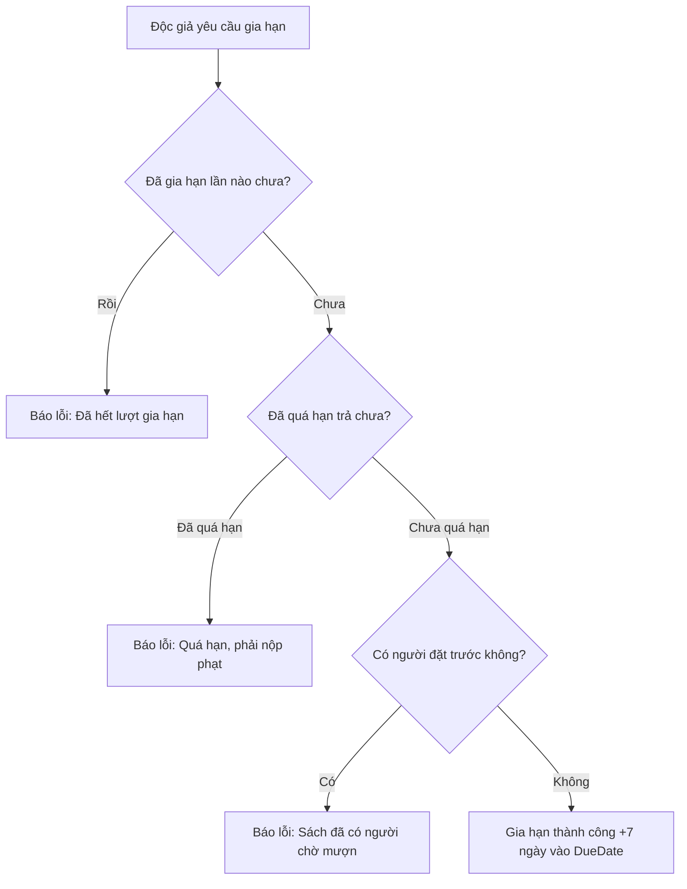
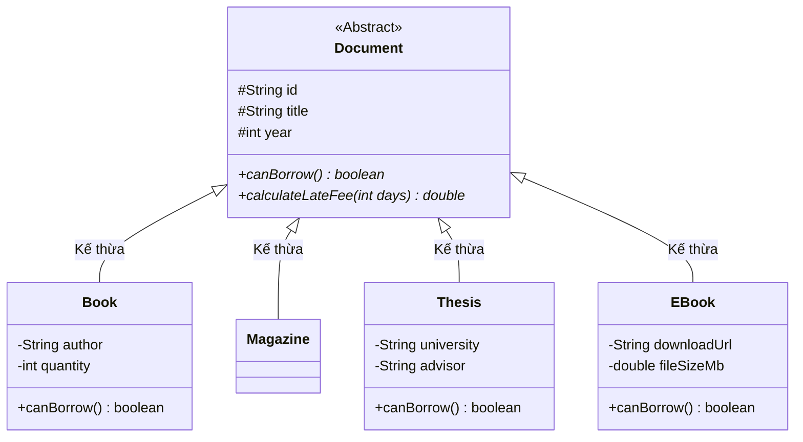

# ĐỀ XUẤT Ý TƯỞNG & TÍNH NĂNG MỞ RỘNG ĐỒ ÁN OOP
## Dự án: Hệ thống Quản lý Thư viện (Library Management System)

&lt;!-- @import &quot;[TOC]&quot; --&gt;

---

## 1. Tổng quan các ý tưởng đề xuất

Tài liệu này tổng hợp các tính năng mở rộng nhằm nâng cấp đồ án từ phiên bản dòng lệnh (CLI) cơ bản lên một hệ thống hoàn thiện, đạt điểm tối đa trong môn **Lập trình Hướng đối tượng (OOP)**. Các tính năng được thiết kế bám sát nghiệp vụ thực tế và tối ưu cho việc trình diễn các nguyên lý: **Encapsulation, Inheritance, Polymorphism, Abstraction, Design Patterns** và **Collection Framework**.

| STT | Tên Tính năng | Nhóm Chuyên đề | Kỹ thuật OOP & Cấu trúc Dữ liệu | Độ ưu tiên |
| :---: | :--- | :--- | :--- | :---: |
| 1 | **Gia hạn mượn sách (Renew Loan)** | Mượn / Trả chuyên sâu | Java Date/Time API, Validation Logic | ⭐⭐⭐⭐⭐ |
| 2 | **Sắp xếp nâng cao (Multi-criteria Sorting)** | Tra cứu & Tìm kiếm | **Strategy Pattern**, `Comparator<Book>`, Stream API | ⭐⭐⭐⭐⭐ |
| 3 | **Hàng đợi đặt trước (Reservation Queue)** | Cấu trúc Dữ liệu | **Queue / LinkedList (FIFO)** | ⭐⭐⭐⭐ |
| 4 | **Báo cáo & Thống kê (Admin Dashboard)** | Phân tích Dữ liệu | Java Stream API, `Map<String, Long>`, Grouping | ⭐⭐⭐⭐ |
| 5 | **Đa dạng hóa tài liệu (Magazine, Thesis, E-Book)** | Mô hình Hóa OOP | **Kế thừa & Đa hình sâu**, Abstract Class | ⭐⭐⭐⭐ |
| 6 | **Ví tiền & Thu phí phạt (Fine Wallet)** | Tài chính & Nghiệp vụ | Encapsulation, State Management | ⭐⭐⭐ |
| 7 | **Giao diện đồ họa (GUI Swing Dashboard)** | Trải nghiệm người dùng | **Kiến trúc MVC**, Java Swing (`JTable`, Event-driven) | ⭐⭐⭐⭐⭐ |

---

## 2. Đặc tả chi tiết từng tính năng

### 2.1. Gia hạn mượn sách (Renew Loan)
* **Ý tưởng nghiệp vụ:** Cho phép độc giả (`Member`) đang mượn sách có thể gia hạn thời gian mượn thêm 7 hoặc 14 ngày nếu chưa đọc xong mà không cần phải mang sách đến thư viện trả rồi mượn lại.
* **Ràng buộc nghiệp vụ (Business Rules):**
  - Mỗi phiếu mượn (`Transaction`) chỉ được gia hạn tối đa **01 lần**.
  - Nếu sách đã bị quá hạn (`LocalDate.now().isAfter(dueDate)`): **Từ chối gia hạn**, yêu cầu mang sách đến trả và nộp tiền phạt.
  - Nếu cuốn sách đó đang có độc giả khác nằm trong danh sách đặt trước (Reservation Queue): **Không cho phép gia hạn**.
* **Kỹ thuật OOP áp dụng:**
  - Bổ sung trường `private boolean isRenewed = false;` vào lớp `Transaction`.
  - Cập nhật ngày hẹn trả: `this.dueDate = this.dueDate.plusDays(7);`.



---

### 2.2. Sắp xếp nâng cao sử dụng Strategy Pattern
* **Ý tưởng nghiệp vụ:** Cho phép người dùng linh hoạt sắp xếp danh mục sách theo nhiều tiêu chuẩn khác nhau:
  1. Theo Tên sách (A -> Z).
  2. Theo Năm xuất bản (Mới nhất -> Cũ nhất).
  3. Theo Số lượng tồn kho (Giảm dần / Tăng dần).
* **Kỹ thuật OOP áp dụng:**
  - Áp dụng **Strategy Pattern** và nguyên lý **Open/Closed Principle (SOLID)** thay vì viết các khối lệnh `switch-case` cồng kềnh.
  - Định nghĩa interface `IBookSorter`:

```java
public interface IBookSorter {
    void sort(List<Book> books);
}

public class SortByTitleAscending implements IBookSorter {
    @Override
    public void sort(List<Book> books) {
        books.sort(Comparator.comparing(Book::getTitle, String.CASE_INSENSITIVE_ORDER));
    }
}

public class SortByYearDescending implements IBookSorter {
    @Override
    public void sort(List<Book> books) {
        books.sort((b1, b2) -> Integer.compare(b2.getPublicationYear(), b1.getPublicationYear()));
    }
}
```

---

### 2.3. Hàng đợi đặt trước sách (Reservation Queue)
* **Ý tưởng nghiệp vụ:** Khi độc giả muốn mượn một cuốn sách nhưng số lượng trong kho đã hết (`quantity == 0`), hệ thống sẽ đưa độc giả vào một hàng đợi chờ (Waiting List).
* **Luồng xử lý khi trả sách:**
  - Khi một độc giả khác mang cuốn sách đó đến trả, hệ thống kiểm tra hàng đợi đặt trước của cuốn sách.
  - Nếu hàng đợi có người đang chờ: Sách sẽ được giữ lại cho người đầu tiên trong hàng đợi (gửi thông báo giữ sách trong 48h), không cộng tự do vào kho chung.
* **Cấu trúc Dữ liệu:**
  - Sử dụng `Queue<String> waitingList = new LinkedList<>()` (chứa các `memberId`) đặt ngay bên trong đối tượng `Book`.
  - Áp dụng chuẩn cơ chế **FIFO (First-In, First-Out)**.

---

### 2.4. Báo cáo & Thống kê dành cho Thủ thư (Admin Dashboard)
* **Ý tưởng nghiệp vụ:** Cung cấp cho Quản trị viên cái nhìn tổng thể về hiệu suất hoạt động của thư viện thông qua menu báo cáo.
* **Các chỉ số phân tích:**
  1. **Top 3 cuốn sách được mượn nhiều nhất:** Thống kê tần suất xuất hiện mã sách trong danh sách `Transaction`.
  2. **Danh sách độc giả đang nợ sách quá hạn:** Lọc các giao dịch có trạng thái `BORROWED` và `LocalDate.now().isAfter(dueDate)`.
  3. **Tổng tiền phạt đã thu được:** Tính tổng `fineAmount` của các giao dịch đã hoàn tất trả sách.
* **Kỹ thuật áp dụng:** Sử dụng sức mạnh của **Java Stream API**:
  - `transactions.stream().filter(...).collect(Collectors.groupingBy(...))`
  - `transactions.stream().mapToDouble(Transaction::getFineAmount).sum()`

---

### 2.5. Đa dạng hóa danh mục tài liệu (Đa hình chuyên sâu)
* **Ý tưởng nghiệp vụ:** Mở rộng thư viện để quản lý nhiều dạng tài liệu học thuật khác nhau ngoài sách thông thường:
  - **Tạp chí (Magazine):** Có số phát hành, kỳ xuất bản (tháng/năm).
  - **Luận văn tốt nghiệp (Thesis):** Có chuyên ngành, giảng viên hướng dẫn, chỉ được đọc tại chỗ (không cho mượn về).
  - **Tài liệu điện tử (E-Book):** Tải về đọc qua file PDF/EPUB, dung lượng file (MB), số lượng mượn không giới hạn.
* **Mô hình Kế thừa (Inheritance Hierarchy):**



---

### 2.6. Ví tiền độc giả & Thanh toán phạt (Fine Wallet)
* **Ý tưởng nghiệp vụ:**
  - Mỗi tài khoản `Member` có thuộc tính `double balance` (Số dư ví).
  - Khi độc giả trả sách muộn bị tính tiền phạt, họ có thể chọn trừ tiền trực tiếp từ ví hoặc nạp thêm tiền.
  - **Ràng buộc:** Nếu số tiền nợ phạt tích lũy vượt quá 50.000 VNĐ, tài khoản tự động chuyển sang trạng thái bị khóa (`banned = true`) theo đúng Tiền điều kiện của **UC-04**.

---

### 2.7. Nâng cấp Giao diện Đồ họa (GUI Swing)
* **Ý tưởng nghiệp vụ:** Thay thế toàn bộ Menu nhập số dòng lệnh bằng ứng dụng cửa sổ thân thiện với người dùng:
  - **Bảng dữ liệu `JTable`:** Danh sách sách có hỗ trợ thanh cuộn `JScrollPane`, nhấp chuột vào dòng để mượn/sửa/xóa.
  - **Tìm kiếm tức thì (Live Search):** Khi người dùng gõ từng chữ cái vào ô tìm kiếm, danh sách sách trên bảng tự động lọc ngay lập tức mà không cần bấm Enter.
  - **Hộp thoại thông báo (`JOptionPane`):** Báo lỗi và xác nhận giao dịch bằng popup trực quan thay vì in văn bản console.

---

## 3. Lộ trình tích hợp vào Codebase

1. **Tuần 1:** Tích hợp **Gia hạn mượn sách** và **Bộ sắp xếp Strategy Pattern** vào các lớp Model/Manager hiện có.
2. **Tuần 2:** Thêm module **Báo cáo Thống kê (Stream API)** vào Menu của Admin.
3. **Tuần 3:** Xây dựng cửa sổ **GUI Swing (MVC)** liên kết với các Manager để chuẩn bị bảo vệ đồ án.
